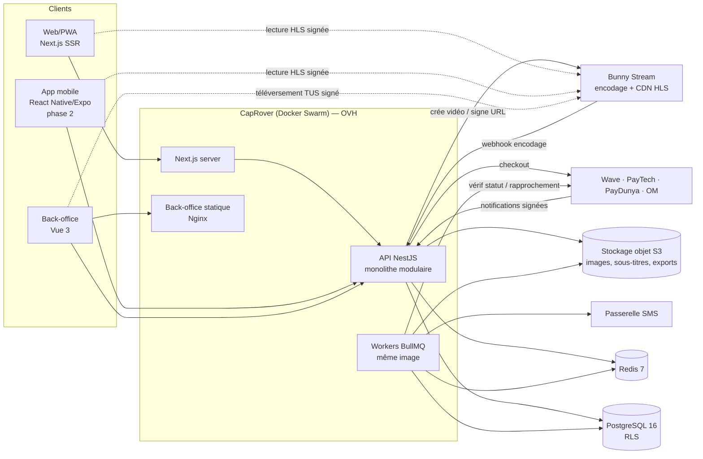
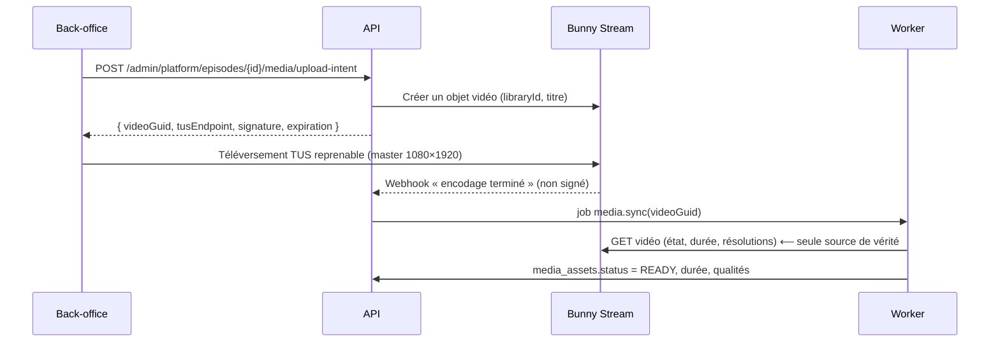
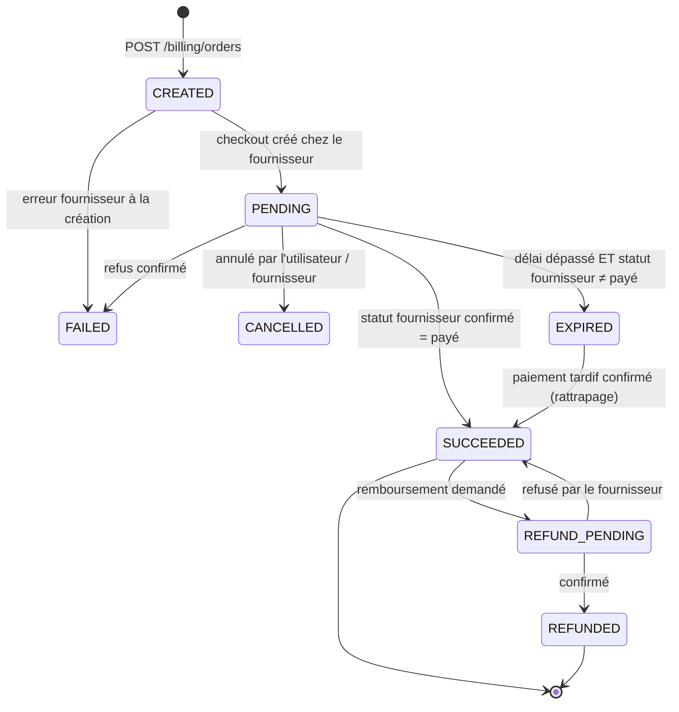
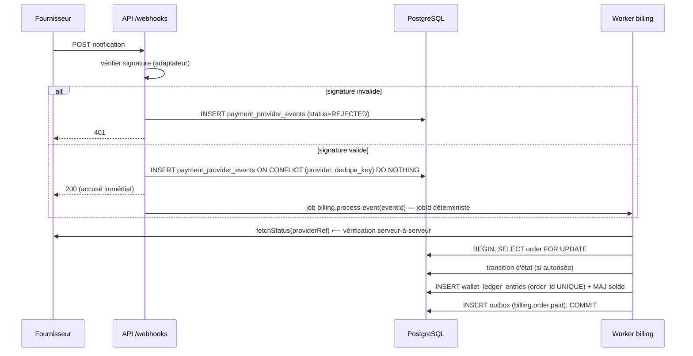
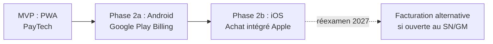

# 02 — TRD · Exigences techniques et architecture

| | |
|---|---|
| Version | 0.2 — **brouillon soumis à validation** (0.2 : PayTech canal principal, 100 séries, stratégie stores §16, marque maison §4.5, Gambie §8.5) |
| Date | 2026-10-19 |
| Référence d'exigences | [01-PRD](01-PRD.md) |

---

## 1. Architecture actuelle constatée (socle réutilisé)

Le produit n'a pas d'existant. Il réutilise le **socle SOOBA** audité en Phase 0 (`sooba-impact-backend`, `sooba-impact-front`, `sooba-impact-web`), dont les faits suivants ont été observés :

| Élément | Constat | Réutilisation |
|---|---|---|
| Backend | NestJS 11, TypeScript 5.7, Prisma 6, PostgreSQL 16, Redis 7, BullMQ, pnpm, Node 22 | **Reprise intégrale du noyau** |
| Architecture | Monolithe modulaire, hexagonal par module, CQRS-lite, outbox transactionnel, frontières vérifiées en CI (ESLint `boundaries`, dependency-cruiser) | Reprise |
| Multi-tenant | Base partagée, `tenant_id` + RLS `FORCE`, rôle applicatif sans `BYPASSRLS`, résolveurs JWT / sous-domaine / en-tête, contexte `AsyncLocalStorage`, test d'isolation bloquant | Reprise **avec adaptation** (§4) |
| IAM | OTP SMS/e-mail sans mot de passe, jetons hachés HMAC, rotation des refresh tokens, RBAC CASL | Reprise **avec adaptation** (utilisateur global) |
| Transverse | Idempotence, verrous Redis, rate-limit par tenant, stockage S3 signé, notifications par ports, observabilité Pino/Prometheus/OTel, `Money` en entiers, `ClockPort` | Reprise |
| Back-office | Vue 3, PrimeVue 4, Pinia, Tailwind 3, Vite 6, vue-i18n, modules tenants/utilisateurs | Reprise (**[VALIDÉ]**) |
| Web public | Next.js 16, React 19, Tailwind 4, i18n, géolocalisation | Reprise des conventions |
| CI/CD | GitLab CI → CapRover | **Portage vers GitHub Actions** → CapRover (**[VALIDÉ]**) |

## 2. Architecture cible

### 2.1 Vue d'ensemble



### 2.2 Monolithe modulaire vs distribué

| Critère | Monolithe modulaire | Microservices |
|---|---|---|
| Équipe et volume MVP | Adapté (1 équipe, < 10 k MAU) | Surdimensionné |
| Transactions paiement → crédits → droits | **Une transaction ACID** | Saga distribuée, risque d'incohérence |
| Exploitation sur CapRover | 2 services (API + worker) | N services, N pipelines |
| Évolution | Frontières de modules déjà vérifiées en CI ; extraction possible d'un module (ex. `playback`) | — |

**Décision [PROPOSÉ] ADR-S01** : monolithe modulaire (même choix que l'ADR-0001 du socle). Point d'extraction prévu : le module `playback` (émission d'URLs signées, très sollicité, sans état) pourra devenir un service séparé si la charge l'exige.

## 3. Dépôts, technologies et versions

**[VALIDÉ]** multi-repo GitHub. Noms proposés :

| Dépôt | Technologie | Origine |
|---|---|---|
| `gaatshort-backend` | NestJS 11, Prisma 6, PostgreSQL 16, Redis 7, BullMQ, Zod, CASL, Pino, OTel | Copie du socle `sooba-impact-backend` **sans les modules métier SOOBA** |
| `gaatshort-backoffice` | Vue 3.5, PrimeVue 4, Pinia 3, vue-router 4, vue-i18n 11, Tailwind 3, Vite 6, Vitest | Copie du socle `sooba-impact-front` (cœur, auth, RBAC, i18n, thème, modules tenants/utilisateurs) |
| `gaatshort-web` | Next.js 16 (App Router, rendu serveur), React 19, Tailwind 4, hls.js, Vitest, Playwright | Conventions de `sooba-impact-web` ; base neuve pour les écrans streaming |
| `gaatshort-mobile` (phase 2) | React Native via **Expo SDK** (EAS Build), `expo-video`, expo-router, TanStack Query | Neuf |
| `gaatshort-contracts` (optionnel) | Client TypeScript généré depuis `openapi.json` | Neuf — publié en paquet privé GitHub Packages |

Justifications :
- **Next.js** pour le web utilisateur : rendu serveur requis pour le référencement des fiches série (FR-CAT-008) ; l'équipe l'utilise déjà.
- **hls.js** sur Android/Chrome/desktop ; HLS natif sur Safari/iOS.
- **Expo** plutôt que React Native nu : builds par marque via profils EAS, mises à jour OTA, `expo-video` gère HLS sur les deux plateformes.
- **Pas de nouvelle technologie serveur** : tout tient dans PostgreSQL + Redis + S3, déjà maîtrisés.

## 4. Stratégie multi-tenant

### 4.1 Comparaison des modèles

| Modèle | Isolation | Coût d'exploitation | Complexité | Adapté ici ? |
|---|---|---|---|---|
| Base partagée + `tenant_id` + RLS | Forte si double rempart | 1 base, 1 migration | Faible | **Oui** |
| Schéma par tenant | Forte | Migrations × N, pool saturé | Moyenne | Option « silo » si un client l'exige par contrat |
| Base par tenant | Maximale | N bases à sauvegarder/superviser | Élevée | Non (catalogue partagé et compte unique l'interdisent pratiquement) |

**Décision [PROPOSÉ] ADR-S02** : base partagée + RLS, comme le socle. Le catalogue partagé (D-02) et le compte unique (D-03) rendent les modèles « base par tenant » quasi impraticables : ils obligeraient à dupliquer le catalogue et l'identité.

### 4.2 Adaptation du socle : trois catégories de tables

| Catégorie | Exemples | `tenant_id` | RLS | Accès |
|---|---|---|---|---|
| **Globales plateforme** | `users`, `series`, `episodes`, `media_assets`, `licenses`, `genres`, `currencies`, `countries` | Non | Non (pas de politique tenant) | Lecture via façades ; écriture réservée aux rôles plateforme |
| **Tenant** | `tenant_memberships`, `wallets`, `wallet_ledger_entries`, `orders`, `payment_attempts`, `entitlements`, `watch_progress`, `favorites`, `tenant_series`, `coin_packs`, `notifications`, `audit_logs` | Oui | **Oui, `FORCE`** | Toujours dans le contexte d'un tenant |
| **Plateforme technique** | `payment_provider_events` (boîte de réception des webhooks), `outbox_messages`, `idempotency_keys` | Oui (nullable pour les webhooks non encore attribués) | Oui, avec chemin `$privileged` documenté | Workers |

Différence avec SOOBA : dans le socle, `users.tenant_id` existe. Ici l'utilisateur est **global** et une table `tenant_memberships (tenant_id, user_id)` porte le rattachement. Conséquences :
- Un administrateur de marque ne lit jamais `users` directement : il passe par une **vue de lecture** `tenant_members_v` qui joint `tenant_memberships` (filtrée par RLS) à `users`, exposant uniquement les champs autorisés.
- Le contrôle d'accès à `users` est donc **applicatif** (aucune requête de module tenant n'y accède sans jointure par membership) ; une règle dependency-cruiser interdit l'accès au dépôt `UserRepository` hors du module `identity`.
- Test d'isolation étendu : attaque SQL brute sur la vue avec un autre `app.current_tenant_id`.

### 4.3 Résolution du tenant

| # | Résolveur | Source | Usage |
|---|---|---|---|
| 1 | `jwt` | Revendication `tid` du jeton d'accès | Utilisateur connecté — fait autorité |
| 2 | `domain` | `request.hostname` → `tenant_domains` (domaine personnalisé ou sous-domaine de `TENANCY_ROOT_DOMAIN`) | Web navigateur |
| 3 | `app-key` | En-tête `X-Tenant-App` = clé publique de l'application mobile de la marque | Mobile (build par marque) |
| 4 | `header` | `X-Tenant-Id` | Dev, tests, serveur-à-serveur interne uniquement (désactivé en production publique) |

Le serveur Next.js (rendu SSR) appelle l'API en transmettant l'hôte d'origine via un en-tête interne signé (`X-Forwarded-Tenant-Host` + HMAC partagé), jamais un identifiant de tenant fourni par le navigateur. Le refus en cas d'incohérence jeton/en-tête (détection d'intrusion) est conservé du socle.

### 4.4 Jetons et compte unique
- `POST /auth/verify` émet un jeton **lié au tenant courant** (`sub` = user global, `tid` = tenant). Un même utilisateur sur deux marques a deux sessions distinctes.
- Création du rattachement à la première connexion sur une marque, après acceptation des CGU de la marque (consentement horodaté).
- Back-office : jetons séparés (`aud=backoffice`) ; un rôle plateforme porte `scope=platform` et ne peut opérer « dans » un tenant qu'en choisissant explicitement ce tenant (journalisé).

### 4.5 Marque maison et marques tierces (D-13)
- `tenants.is_first_party = true` désigne la **marque maison**, exploitée par la plateforme elle-même, qui détient directement les licences.
- La fonction de disponibilité `series_available(série, pays, instant, tierce)` reçoit `tierce = NOT is_first_party`. Une marque tierce ne voit **que** les séries dont la licence porte `sublicensing_allowed = true`. Ce contrôle est fait dans la base, pas seulement dans l'interface.
- Valeur par défaut d'une nouvelle licence : `sublicensing_allowed = false`. Passer à `true` exige une pièce jointe du contrat, et le changement est audité.
- Au lancement, en l'absence de droits de sous-licence documentés, seule la marque maison peut diffuser le catalogue. Les marques tierces sont activées série par série, au fil de la régularisation des contrats.

## 5. Modules backend (bounded contexts)

| Module | Rôle | Exigences |
|---|---|---|
| `identity` (adaptation de `iam`) | Utilisateurs globaux, OTP, sessions, rattachements, rôles | FR-AUTH-* |
| `tenancy` (socle) | Tenants, domaines, branding, configuration, pays/devises/moyens de paiement actifs | FR-TEN-* |
| `localization` (socle) | Pays, devises, E.164 | NFR-I18N-001 |
| `catalog` (neuf) | Séries, épisodes, genres, étiquettes, traductions, licences, disponibilité, import en lot | FR-CAT-*, FR-ADM-001..005, FR-ADM-009 |
| `media` (neuf) | Actifs vidéo et images, encodage, sous-titres — port `VideoProviderPort` | FR-ADM-002/003 |
| `storefront` (neuf) | Sélection du catalogue par marque, rangées d'accueil, prix, classements, recherche | FR-CAT-001..005, FR-TEN-005 |
| `playback` (neuf) | Décision d'accès, émission d'URLs signées, progression, événements de lecture | FR-VIDEO-* |
| `library` (neuf) | Favoris, continuer à regarder, historique | FR-LIB-* |
| `wallet` (neuf) | Portefeuilles, grand livre de crédits, déblocages, droits (`entitlements`) | FR-MON-* |
| `billing` (neuf) | Packs, commandes, tentatives de paiement, adaptateurs fournisseurs (PayTech au MVP ; Wave, PayDunya ; stores en phase 2), webhooks, rapprochement, remboursements | FR-PAY-* |
| `notifications` (socle) | SMS, e-mail, in-app ; push en phase 2 | FR-NOTIF-* |
| `analytics` (socle) | Événements partitionnés, agrégats, tableaux de bord | FR-ADM-008 |
| `compliance` (socle) | Consentements, export/effacement | FR-AUTH-006, NFR-COMP-001 |

Communication inter-modules : **façades** synchrones pour les lectures, **événements outbox** pour les effets (ex. `billing.order.paid` → `wallet` crédite). Les modules SOOBA spécifiques (`applications`, `partners`, `talent-pool`, `simulation`, `cms`, `news`, `marketing`, `documents`) ne sont **pas** repris.

## 6. API et contrats

- Conventions du socle conservées : préfixe `/api/v1`, enveloppe `{ success, data, requestId }`, catalogue de codes d'erreur, **404 pour une ressource d'un autre tenant**, pagination curseur pour les listes publiques, `Idempotency-Key` obligatoire sur les créations (commandes, déblocages).
- `openapi.json` exporté et comparé en CI ; client TypeScript généré pour web, back-office et mobile.

Endpoints principaux (détail des schémas dans le code ; liste indicative) :

| Domaine | Endpoints |
|---|---|
| Auth | `POST /auth/challenge`, `POST /auth/verify`, `POST /auth/refresh`, `POST /auth/logout`, `GET /me`, `PATCH /me`, `DELETE /me` |
| Vitrine | `GET /storefront/home`, `GET /storefront/series?genre&cursor`, `GET /storefront/series/{slug}`, `GET /storefront/search?q`, `GET /storefront/genres`, `GET /storefront/config` (branding, langues, moyens de paiement) |
| Lecture | `POST /playback/episodes/{id}/session` → `{ hlsUrl, expiresAt, subtitles[], startPosition }` ; `PUT /playback/progress` ; `POST /playback/events` (lot) |
| Bibliothèque | `GET/PUT/DELETE /library/favorites/{seriesId}`, `GET /library/continue-watching` |
| Portefeuille | `GET /wallet`, `GET /wallet/ledger?cursor`, `POST /wallet/unlocks` (Idempotency-Key) |
| Achat | `GET /billing/coin-packs`, `GET /billing/payment-methods`, `POST /billing/orders` (Idempotency-Key) → `{ orderId, redirectUrl, expiresAt }`, `GET /billing/orders/{id}`, `GET /billing/orders?cursor` ; phase 2 : `POST /billing/store-purchases` (reçu Google Play / App Store) |
| Import catalogue | `POST /admin/platform/imports` (manifeste CSV), `GET /admin/platform/imports/{id}` (avancement, erreurs) |
| Webhooks | `POST /webhooks/payments/{provider}/{accountKey}` (PayTech IPN, Wave, PayDunya ; phase 2 : App Store Server Notifications, Google RTDN), `POST /webhooks/video/bunny/{secretPath}` |
| Back-office | `/admin/platform/*` (tenants, catalogue, licences, médias, finances) et `/admin/tenant/*` (vitrine, prix, membres, commandes) |

## 7. Streaming, transcodage et CDN

### 7.1 Options comparées

| Critère | **Bunny Stream** | S3 + transcodage maison (FFmpeg) + CDN | Mux / Cloudflare Stream |
|---|---|---|---|
| Encodage | Gratuit (H.264 jusqu'en 1080p) | Serveur CPU à dimensionner, file, supervision | Facturé à la minute |
| Stockage | 0,01 $/Go/mois (+ régions répliquées) | Prix S3 du fournisseur | Inclus/facturé |
| Diffusion | CDN intégré, PoP en Afrique (Lagos, Johannesburg, Le Caire, Nairobi, Casablanca…) — **pas de PoP à Dakar identifié** | CDN à choisir et configurer | CDN intégré |
| Protection | Jeton SHA-256 signé côté serveur, restriction de domaine, DRM MediaCage en option (99 $/mois + par licence) | À construire | Inclus |
| Effort | Faible | Élevé | Faible |
| Coût pour 100 séries (≈ 6 000 épisodes, 200 h) | ≈ 6 $/mois de stockage, encodage gratuit, hors bande passante | ≈ 200 h de vidéo × 4 qualités à encoder sur des serveurs CPU dédiés, plus le stockage et l'exploitation | Encodage facturé à la minute |

**Décision [PROPOSÉ] ADR-S03** : **Bunny Stream**, encapsulé derrière `VideoProviderPort` (créer vidéo, signer un téléversement, récupérer l'état, signer une URL de lecture, ajouter des sous-titres, supprimer). Réévaluation si le coût CDN dépasse un seuil défini (ex. > 30 % du chiffre d'affaires) ou si une licence impose un DRM incompatible.

Tarifs ci-dessus relevés le 2026-10-19 sur la documentation Bunny et des sources secondaires ; le tarif CDN Afrique (≈ 0,06 $/Go selon une source secondaire) est **[À CONFIRMER]** sur la grille officielle.

### 7.2 Pipeline d'ingestion



Le webhook Bunny n'étant pas considéré comme authentifié, il ne sert que de **déclencheur** : l'état est toujours relu par l'API Bunny. L'URL du webhook contient un segment secret pour limiter le bruit.

### 7.3 Lecture protégée
1. Le client demande une session de lecture (`POST /playback/episodes/{id}/session`).
2. `playback` vérifie : épisode publié par la marque, licence valide pour le pays (pays déterminé côté serveur par l'IP + le pays du profil, voir §10), et **droit** : épisode gratuit **ou** `entitlement` existant.
3. Il émet une URL HLS signée par **jeton de répertoire** (le jeton couvre la playlist maître et tous les segments) valable **30 min** par défaut, plus les URLs des sous-titres.
4. Le client lit ; à expiration en cours de lecture, il redemande une session (transparent).
5. Les flux de prévisualisation (bandes-annonces) sont publics mais signés à durée longue pour éviter le hotlinking.

Pas de liaison à l'IP (les IP mobiles changent souvent). Limitation de débit des sessions par utilisateur (ex. 120/heure) pour détecter les extractions massives.

### 7.4 Profils d'encodage et économie de données
Format vertical 9:16. Échelons activés : 240p, 360p, 480p, 720p (1080p désactivé au MVP pour maîtriser stockage et bande passante). Mode économie de données : le lecteur plafonne la sélection à 360p. Estimation : un épisode de 2 min ≈ 9 Mo en 360p, ≈ 22 Mo en 720p.

### 7.5 Coûts et volumes vidéo (hypothèses à valider — Q-10)

**Catalogue de lancement : 100 séries.**

| Hypothèse | Valeur |
|---|---|
| Épisodes par série (moyenne) | 60 → **≈ 6 000 épisodes** |
| Durée moyenne d'un épisode | 2 min → **≈ 12 000 min (200 h)** |
| Taille encodée par épisode (240p + 360p + 480p + 720p) | ≈ 50 Mo |
| Stockage Bunny (région principale + 1 réplique) | ≈ 300 Go → **≈ 6 $/mois** |
| Masters (1080×1920, ≈ 150 Mo par épisode) conservés en stockage froid hors Bunny | ≈ 0,9 To → quelques euros par mois **[À CONFIRMER]** |
| Encodage H.264 standard | 0 $ |
| Sous-titres générés par IA, si absents (FR + EN) | 12 000 min × 2 × 0,10 $ ≈ **2 400 $ une fois** + relecture humaine |

**Diffusion :**

| Hypothèse | Valeur |
|---|---|
| Utilisateurs actifs mensuels | 10 000 |
| Épisodes vus par utilisateur et par mois | 30 |
| Volume moyen livré par épisode | 15 Mo (mélange 360p/480p/720p) |
| Volume mensuel | ≈ 4,5 To |
| Coût CDN à 0,06 $/Go (à confirmer) | ≈ 270 $/mois |

Le coût dépend de l'**audience**, pas de la taille du catalogue : stocker 100 séries coûte moins de 10 $/mois. Le poste à surveiller reste la bande passante, et notamment les 500 épisodes gratuits (5 × 100 séries), qui en consomment sans rien rapporter.

### 7.6 Ingestion de 100 séries
Un téléversement manuel épisode par épisode depuis le back-office n'est pas tenable : environ 6 000 fichiers et ~1 To de masters. À 50 Mbit/s montants, une connexion de bureau à Dakar mettrait environ 45 h de transfert continu.
1. Les masters sont déposés une fois dans un **bucket de dépôt** (stockage objet), depuis le support livré par l'ayant droit ou par transfert serveur à serveur.
2. Un **manifeste CSV** par série décrit : slug, titres FR/EN, synopsis, genres, numéro, titre et fichier de chaque épisode, fichiers de sous-titres, affiche, référence de licence.
3. La commande d'import (`catalog:import`, exécutée par un worker) valide le manifeste, crée séries et épisodes en `DRAFT`, puis demande à Bunny de **récupérer chaque vidéo par URL signée** (*fetch*) : aucun binaire ne transite par l'API. Elle suit l'encodage et produit un rapport d'erreurs par épisode.
4. L'import est **idempotent** (clé = slug série + numéro d'épisode) et reprenable.
5. Débit limité (ex. 20 encodages simultanés) pour respecter les quotas Bunny.

## 8. Architecture des paiements

### 8.1 Principe
Un module `billing` indépendant des fournisseurs : une **commande** interne, des **tentatives de paiement** chez un fournisseur, une **boîte de réception** des notifications, une machine à états unique, et des adaptateurs implémentant `PaymentProviderPort` :

```ts
interface PaymentProviderPort {
  readonly code: 'WAVE' | 'PAYTECH' | 'PAYDUNYA' | 'ORANGE_MONEY';
  createCheckout(input: CheckoutInput): Promise<CheckoutResult>;          // redirectUrl, providerRef, expiresAt
  verifyNotification(raw: RawHttpRequest): NotificationVerification;      // signature valide ? événement normalisé
  fetchStatus(providerRef: string): Promise<ProviderPaymentStatus>;       // source de vérité
  refund(input: RefundInput): Promise<RefundResult>;                      // si supporté
  capabilities(): ProviderCapabilities;                                   // devises, pays, remboursement, webhooks signés
}
```

### 8.2 Matrice fournisseurs (constats du 2026-10-19)

| Point | Wave Checkout | PayTech | PayDunya | Orange Money direct |
|---|---|---|---|---|
| Pays / devises | SN XOF ; GM (compte gambien distinct, GMD **[À CONFIRMER]**) | SN (XOF) — pas de GMD | 6 pays UEMOA, XOF — pas la Gambie | SN XOF |
| Prérequis marchand | Compte Wave Business, clé API par portefeuille | Compte activé en production (NINEA, RCCM, statuts…) | Compte + application, clés maître/privée/jeton | Compte développeur Orange + KYC entreprise |
| Intégration | Session de paiement → `wave_launch_url` (à ouvrir dans le navigateur, **jamais** dans une webview) | `request-payment` → `redirect_url` (page hébergée) ; `target_payment` pour présélectionner | Facture checkout → URL hébergée | OAuth + `webpayment` → URL |
| Confirmation serveur | Webhook signé HMAC-SHA256 (`Wave-Signature: t=…,v1=…`) + `GET /checkout/sessions/:id` | IPN `sale_complete` avec `hmac_compute` = HMAC-SHA256(`montant|ref_command|api_key`, `api_secret`) + `GET payment/get-status` | IPN + confirmation de facture par jeton (mécanisme de signature **[À CONFIRMER]**) | Notification non garantie → interrogation du statut |
| Signature des requêtes sortantes | Optionnelle (recommandée) + liste blanche d'IP | Clés en en-têtes | Clés en en-têtes | OAuth |
| Remboursement | `POST /checkout/sessions/:id/refund` (idempotent) | `refund-payment` + IPN `refund_complete` | **[À CONFIRMER]** | Pas d'API publique identifiée |
| Expiration | 30 min par défaut ; `expire` disponible | **[À CONFIRMER]** | **[À CONFIRMER]** | **[À CONFIRMER]** |
| Test | Pas de bac à sable identifié | `env=test` débite réellement 100–150 XOF | Mode test | Bac à sable |
| Usage MVP | Adaptateur optionnel (S) : frais réduits, secours | **Adaptateur principal (M)** — compte d'encaissement de la plateforme (D-07) ; `target_payment` = `Wave`, `Orange Money`, `Free Money`, `Carte Bancaire` | Adaptateur de secours (S) | Après MVP |

### 8.3 Machine à états d'une commande



`EXPIRED → SUCCEEDED` existe volontairement : un paiement mobile peut aboutir après le délai ; l'argent encaissé doit toujours être crédité (ou remboursé), jamais ignoré.

### 8.4 Traitement d'une notification (chemin critique)



Garanties :
- **Idempotence** à trois niveaux : `payment_provider_events(provider, dedupe_key)` unique ; `wallet_ledger_entries.order_id` unique pour le crédit d'achat ; transitions d'état vérifiées sous verrou de ligne.
- **Montant et devise** de la notification et du statut fournisseur comparés à la commande ; tout écart → `MISMATCH` en revue manuelle, aucun crédit.
- Les notifications sont conservées brutes (corps chiffré, en-têtes filtrés) pour audit.
- **Interrogation active** : un job interroge le statut des commandes `PENDING` à 1, 3, 10, 30 min puis à l'expiration, pour les fournisseurs sans notification fiable.
- **Rapprochement** quotidien : comparaison des transactions du fournisseur (API de recherche ou export) avec les commandes ; écarts classés (payé non crédité, crédité non payé, montant différent).

### 8.5 Montants et devises
- Montants en `BIGINT` unité mineure (`XOF` : 0 décimale ; `GMD` : 2 décimales → 1 GMD = 100 bututs). VO `Money` du socle remonté dans `shared/kernel`.
- Chaque pack a un prix **par devise** saisi explicitement ; **aucune conversion automatique** XOF↔GMD.
- Taxes : champ `tax_rate_bps` et `tax_inclusive` par pays et par marque **[À CONFIRMER]** avec le comptable ; le prix affiché est TTC.
- **Gambie au lancement (D-12)** : `tenant_countries(GM).currency_code = 'XOF'`, moyen de paiement unique `CARD` sur le compte PayTech, sous réserve que PayTech accepte les cartes gambiennes (Q-11). Le passage en GMD consistera à créer les prix GMD des packs, à changer la devise du pays et à activer Wave Gambie : c'est un changement de configuration, sans migration.

### 8.6 Moyens de paiement par canal

| Canal | Sénégal | Gambie |
|---|---|---|
| Web / PWA (MVP) | PayTech : Wave, Orange Money, Free Money, carte | PayTech : carte (XOF) |
| Android Google Play (phase 2a) | Google Play Billing | Google Play Billing |
| iOS App Store (phase 2b) | Achat intégré Apple | Achat intégré Apple |

## 9. Stockage, base de données et cache

| Besoin | Solution |
|---|---|
| Données transactionnelles | PostgreSQL 16, rôle applicatif sans `BYPASSRLS`, PgBouncer en mode transaction |
| Recherche | `pg_trgm` + `unaccent` (fonction immuable déjà présente dans le socle) sur titres/étiquettes ; pas de moteur externe au MVP |
| Événements de lecture | Table partitionnée par mois (ADR-0007 du socle) |
| Cache | Redis : configuration de marque (TTL 5 min, invalidée à l'écriture), vitrine d'accueil (TTL 60 s), classements (recalcul toutes les 15 min) |
| Fichiers | S3 compatible (OVH Object Storage ou Scaleway) : affiches, bannières, logos, sous-titres sources, exports ; servis via CDN Bunny Pull Zone |

## 10. Sécurité et protection des données

| Sujet | Mesure |
|---|---|
| Isolation | Double rempart (extension Prisma + RLS `FORCE`), vue membres, tests d'isolation par table en CI |
| Authentification | OTP 6 chiffres haché HMAC, 5 essais, TTL 5 min, anti-énumération, limitation par numéro et par IP, protection contre le pompage SMS (plafond quotidien par préfixe pays, CAPTCHA invisible déclenché au-delà d'un seuil) |
| Autorisation | CASL côté serveur sur chaque cas d'usage ; aucun droit déduit du client |
| Géolocalisation (licences) | Pays = pays de l'IP (base MaxMind GeoLite, déjà utilisée par le socle web) ; à défaut, pays du numéro. Contournement par VPN accepté comme risque résiduel **[À CONFIRMER]** selon les contrats |
| Secrets | Variables CapRover chiffrées ; identifiants fournisseurs par compte stockés chiffrés (AES-256-GCM, clé maîtresse hors base) dans `payment_provider_accounts` |
| Webhooks | Signature vérifiée, horodatage contrôlé (Wave : fenêtre 5 min), corps brut conservé, URL non devinable par compte |
| Données personnelles | Minimisation (numéro, nom affiché, pays), consentement par marque, export et effacement, durées de conservation (05-BACKEND-SCHEMA §11) |
| Dépendances | `pnpm audit`, Dependabot, analyse d'image (Trivy) en CI |
| En-têtes | Helmet, CSP stricte sur web et back-office, cookies `HttpOnly`/`Secure`/`SameSite=Lax` pour les jetons web |

## 11. Observabilité et journalisation

Reprise du socle : logs Pino corrélés et expurgés, `/health/live` et `/health/ready`, métriques Prometheus **sans label tenant à haute cardinalité**, traces OpenTelemetry. Ajouts :

| Métrique | Alerte |
|---|---|
| `payments_pending_over_10m` | > 0 pendant 15 min |
| `payment_webhook_rejected_total` (signature invalide) | pic anormal |
| `ledger_mismatch_total` (rapprochement) | > 0 |
| `playback_session_denied_total` par motif | pic |
| `outbox_lag_seconds` | > 60 s |
| Taux d'erreur 5xx | > 1 % sur 5 min |

Outils : Sentry (déjà prévu dans `.env.example` du socle), Prometheus + Grafana auto-hébergés sur CapRover ou service géré **[PROPOSÉ]**.

## 12. Déploiement, scalabilité et résilience

- **CapRover** (Docker Swarm) sur VPS OVH ; une image backend, rôles `api` / `worker` / `migrate` (mécanique du socle : migrations + RLS sous verrou consultatif au démarrage de l'API, `start-first` + rollback Swarm, smoke test vérifiant la **version**).
- **GitHub Actions** : `install → quality (lint, depcruise, typecheck, openapi:diff) → test (unit, integration avec Testcontainers, e2e) → build image → push GHCR (tag = SHA) → caprover deploy --imageName → smoke`. Déploiement production déclenché par tag ou approbation d'environnement GitHub.
- PostgreSQL : **service géré recommandé** (OVH Managed PostgreSQL) pour PITR et sauvegardes ; à défaut, conteneur dédié + `pgBackRest` vers stockage objet. **[PROPOSÉ]**
- Scalabilité : API sans état (×2 réplicas minimum), workers ×2, Redis unique au MVP. Le gros du trafic (vidéo) ne touche pas les serveurs.
- Résilience paiement : bascule d'un fournisseur à l'autre par configuration de marque, sans déploiement.

## 13. Environnements

| Env | Usage | Paiements | Vidéo |
|---|---|---|---|
| `local` | Développement (docker-compose du socle : Postgres, Redis, MinIO, Mailpit) | **Simulateur de fournisseur** interne (adaptateur `FAKE`) | Bibliothèque Bunny de dev |
| `test` (CI) | Tests automatisés | `FAKE` | Port simulé |
| `staging` | Recette, démonstration marques | PayTech `env=test` (débite réellement 100–150 XOF) ; Wave réel à faible montant si l'adaptateur est activé ; stores en mode test (testeurs de licence Google, Sandbox Apple) en phase 2 | Bibliothèque Bunny staging |
| `production` | Public | Réels | Bibliothèque Bunny prod |

## 14. Décisions d'architecture (synthèse)

| ADR | Décision | Alternatives écartées | Statut |
|---|---|---|---|
| S01 | Monolithe modulaire NestJS (socle SOOBA) | Microservices | PROPOSÉ |
| S02 | Base partagée + RLS ; tables globales pour catalogue et identité | Schéma/base par tenant | PROPOSÉ |
| S03 | Bunny Stream derrière `VideoProviderPort` | S3 + FFmpeg ; Mux | PROPOSÉ |
| S04 | Paiements : commande interne + adaptateurs ; **PayTech seul fournisseur obligatoire au MVP** (encaissement plateforme), Wave direct et PayDunya en secours | Intégrations directes multiples dès le MVP | **VALIDÉ** (encaissement PayTech) / PROPOSÉ (secours) |
| S05 | Grand livre de crédits (écritures immuables) + solde dénormalisé contrôlé | Solde seul modifié en place | PROPOSÉ |
| S06 | Web Next.js SSR + PWA d'abord ; mobile Expo en phase 2 | Mobile d'abord | PROPOSÉ (lié à Q-04) |
| S07 | Back-office Vue 3 du socle | Réécriture React | **VALIDÉ** |
| S08 | CapRover + GitHub Actions + GHCR | Dokploy ; GitLab | **VALIDÉ** |
| S09 | Stores : PWA d'abord, puis Android et iOS avec achats intégrés et portefeuille commun ; une application par marque, sous le compte développeur de la marque (§16) | Mobile money dans l'application ; application en consommation seule ; APK hors store | PROPOSÉ |
| S10 | Marque maison (`is_first_party`) ; sous-licence obligatoire pour les marques tierces, contrôlée dans la base | Contrôle uniquement dans l'interface | PROPOSÉ |
| S11 | Ingestion en lot par manifeste CSV et récupération par URL côté Bunny | Téléversement manuel | PROPOSÉ |

## 15. Coûts prévisionnels mensuels (ordre de grandeur, hors salaires)

| Poste | Estimation | Commentaire |
|---|---|---|
| VPS OVH (API, workers, web, back-office) | 30–60 € | 2 VPS 8 Go recommandés (prod) + 1 staging |
| PostgreSQL géré | 25–60 € | Selon offre OVH |
| Stockage objet | < 5 € | Images et sous-titres |
| Bunny Stream | 5 € + bande passante (§7.5) | Poste qui croît avec l'audience |
| SMS OTP | 15–30 FCFA/SMS **[À CONFIRMER]** | Poste significatif : limiter les renvois |
| Frais de paiement | 1–3 % du montant selon fournisseur **[À CONFIRMER]** | Négociables avec le volume |
| Sentry / supervision | 0–30 € | Offre gratuite au départ |
| Bunny Stream — stockage 100 séries | ≈ 6 $ | §7.5 |
| Sous-titres IA (si nécessaires) | ≈ 2 400 $ une fois | §7.5, Q-10 |
| Comptes développeur stores (phase 2) | Apple 99 $/an, Google 25 $ une fois, **par compte** | Un compte par marque publiée |
| Commission stores (phase 2) | 15 % (programmes petites entreprises) à 30 % du chiffre d'affaires in-app **[À CONFIRMER]** | Compensée par des prix in-app majorés |

## 16. Stratégie de distribution mobile et facturation des stores

### 16.1 Constats (vérifiés au 2026-10-19)
| Store | Règle | Conséquence |
|---|---|---|
| Apple 3.1.1 | Débloquer du contenu ou une monnaie virtuelle impose l'achat intégré | Les packs de crédits doivent être vendus en achat intégré dans l'app iOS |
| Apple 3.1.3(b) | Accès autorisé aux contenus achetés sur d'autres plateformes **si les mêmes articles sont aussi vendus en achat intégré** | Les crédits achetés sur le web sont utilisables dans l'app iOS, puisque les packs y sont aussi vendus |
| Apple 4.2.6 | Une application issue d'un modèle doit être soumise par le fournisseur du contenu (texte de 2017, **[À CONFIRMER]**) | Une application par marque, sous **son** compte développeur |
| Google Play — paiements | Facturation Play obligatoire pour le contenu numérique ; interdiction d'orienter vers un autre moyen de paiement ; « toute application peut être en consommation seule » | Packs en Google Play Billing ; aucune mention ni lien vers l'achat web dans l'app |
| Google Play — facturation alternative | Non ouverte au Sénégal ni à la Gambie ; programme mondial annoncé pour fin septembre 2027 | Pas de mobile money dans l'app Android d'ici là |

### 16.2 Séquencement

Android passe avant iOS parce qu'il représente la grande majorité du parc au Sénégal et en Gambie (part exacte **[À CONFIRMER]**). La PWA reste disponible sur tous les appareils, y compris l'iPhone.

### 16.3 Architecture technique des achats intégrés
- Deux nouveaux adaptateurs `GOOGLE_PLAY` et `APP_STORE`, qui implémentent le même `PaymentProviderPort`. Sur mobile, `createCheckout` est remplacé par la validation d'un reçu transmis par l'application.
- **Produits** : chaque pack de la marque correspond à un produit consommable par store (`coin_pack_store_products`). Le prix est fixé dans la console du store, sur ses paliers et dans sa devise. Le serveur ne fait confiance qu'au **produit**, jamais au prix envoyé par l'application.
- **Flux Android** : achat via Play Billing Library → l'app envoie `purchaseToken` + `productId` à `POST /billing/store-purchases` → le serveur appelle l'API Google Play Developer (`purchases.products.get`) → crédit dans la même transaction que pour PayTech → **consommation** et accusé de réception de l'achat (sinon Google le rembourse automatiquement au bout de 3 jours) → notifications en temps réel (RTDN via Cloud Pub/Sub) et API des achats annulés pour les remboursements.
- **Flux iOS** : StoreKit 2 → l'app envoie la transaction signée (JWS) → le serveur vérifie la signature et appelle l'App Store Server API (*Get Transaction Info*) → crédit → App Store Server Notifications V2 (signées) pour `REFUND`.
- **Idempotence** : `payment_attempts(provider, provider_ref)` est unique ; `provider_ref` vaut `purchaseToken` chez Google et `transactionId` chez Apple. Une même transaction ne crédite qu'une fois, même si l'app la renvoie au redémarrage.
- **Remboursement initié par le store** : écriture `REFUND_REVERSAL` dans la limite du solde payé ; le reliquat déjà dépensé est tracé (`coins_unrecoverable`). Les remboursements répétés sur un même compte déclenchent une alerte de fraude.
- **Portefeuille commun** : même `wallets` par (marque, utilisateur), quel que soit le canal (FR-PAY-014).
- **Devise** : la commande enregistre le montant et la devise **déclarés par le store** (souvent l'USD : **[À CONFIRMER]** pour le Sénégal et la Gambie), à des fins de reporting uniquement. La table `currencies` accueille donc aussi l'USD.

### 16.4 Builds et comptes par marque
- Un seul dépôt `gaatshort-mobile` (Expo). Chaque marque a un **profil EAS** : nom, identifiant de bundle, icônes, couleurs, `app_public_key` (résolveur `app-key`), identifiants des produits store.
- **Marque maison** : publiée sous le compte développeur de la plateforme.
- **Marque tierce** : publiée sous **son propre** compte Apple Developer et Google Play. La plateforme prépare et soumet le build en tant que membre invité du compte. Les revenus des stores arrivent sur le compte de la marque : la plateforme facture alors sa part (reversement **inverse** par rapport au web). La vérification serveur exige les identifiants de l'API store de **chaque** compte, stockés chiffrés dans `payment_provider_accounts` (`owner_tenant_id` renseigné).
- Les mises à jour JavaScript passent par EAS Update (le contenu du catalogue ne nécessite jamais de nouvelle version) ; les changements natifs passent par une nouvelle soumission.

### 16.5 Règles d'interface dans les applications
- Aucun texte, lien ou bouton orientant vers l'achat sur le web ni ne mentionnant un prix web.
- La boutique (SCR-07) affiche les produits et prix renvoyés par le store ; SCR-08 (choix du moyen de paiement) est remplacé par la feuille de paiement native du store.
- La connexion, le profil, la lecture et le portefeuille sont identiques au web.
