# 03 — APPFLOW · Parcours et navigation

| | |
|---|---|
| Version | 0.2 — **brouillon soumis à validation** (0.2 : paiement via PayTech, import en lot FLOW-13b, achat store FLOW-17) |
| Date | 2026-10-19 |
| Références | Exigences : [01-PRD](01-PRD.md) · Écrans : [04-UI-UX-Design](04-UI-UX-Design.md) · Endpoints : [02-TRD §6](02-TRD.md) |

Chaque flux précise : **conditions d'entrée**, **étapes** (action → réponse système), **erreurs**, **résultat**. Les identifiants d'écran `SCR-xx` (utilisateur) et `BO-xx` (back-office) sont définis dans 04-UI-UX-Design.

---

## 1. Cartographie des écrans

### 1.1 Application utilisateur (web/PWA, puis mobile)

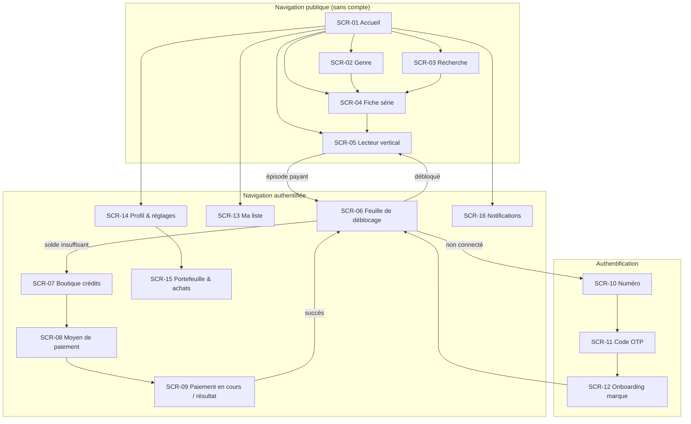

Barre de navigation basse (mobile/PWA) : **Accueil** · **Découvrir** (genres + recherche) · **Ma liste** · **Profil**. Le solde de crédits est visible en haut de l'accueil et dans le lecteur.

### 1.2 Back-office

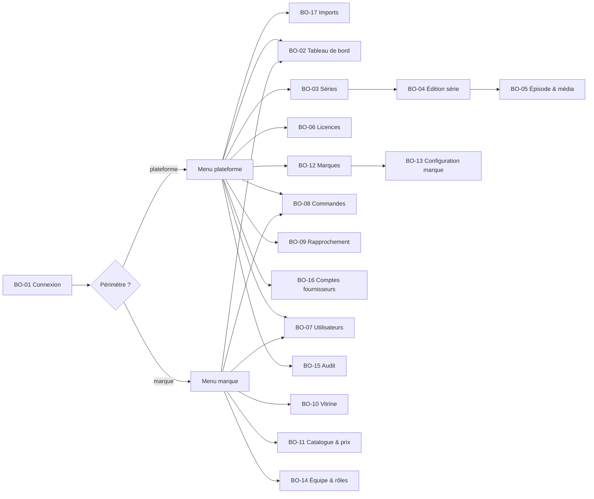

## 2. Flux utilisateur

### FLOW-01 — Inscription / connexion par OTP (FR-AUTH-001, 003, 004, 005)

**Entrée** : visiteur anonyme ; déclencheurs = épisode payant, favori, boutique, profil.

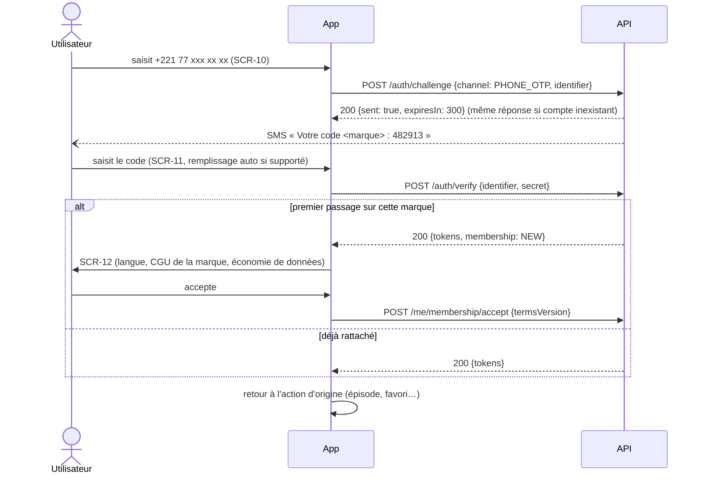

| Erreur | Réponse système |
|---|---|
| Numéro invalide / pays non ouvert par la marque | Message inline, envoi bloqué |
| Trop de demandes (numéro ou IP) | `429` — « Réessayez dans X min » + compte à rebours |
| Code faux | « Code incorrect » (essais restants non divulgués au-delà de « plusieurs ») ; au 5ᵉ échec, le défi est invalidé |
| Code expiré | Bouton « Renvoyer » (après 60 s, maximum 3 renvois / 15 min) |
| SMS non reçu | Après 60 s : proposer l'OTP e-mail (si FR-AUTH-002 livré) |
| CGU refusées | Pas de rattachement ; retour en navigation anonyme |

**Résultat** : session liée à la marque ; rattachement créé avec consentement horodaté.

### FLOW-02 — Onboarding (premier lancement)

**Entrée** : première visite sur une marque (aucune préférence stockée).
1. Détection de la langue (navigateur, pays IP) → FR au Sénégal, EN en Gambie, modifiable.
2. Écran d'accueil directement (pas de carrousel d'introduction bloquant) ; bannière discrète : « Les 5 premiers épisodes de chaque série sont gratuits ».
3. Sur réseau cellulaire détecté (Network Information API si disponible), économie de données activée par défaut et signalée une fois.

**Résultat** : préférences locales (langue, économie de données) ; aucune donnée serveur sans compte.

### FLOW-03 — Récupération de compte

Pas de mot de passe : « récupérer » = se reconnecter par OTP sur le numéro.
- **Changement de numéro** : depuis SCR-14, connecté, OTP sur l'ancien **et** le nouveau numéro.
- **Numéro perdu, plus d'accès** : demande au support (BO-07) ; vérification manuelle (dernier achat : montant, date, moyen) ; transfert journalisé dans l'audit. **[PROPOSÉ]**

### FLOW-04 — Accueil et découverte (FR-CAT-001, 002, 005, 007)

**Entrée** : toute visite.

| Étape | Système |
|---|---|
| Ouverture SCR-01 | `GET /storefront/home` (rendu serveur sur le web, cache 60 s par marque/langue/pays) |
| Rangées | À la une (bannière), Continuer à regarder (si connecté), Nouveautés, Populaires, rangées par genre configurées par la marque |
| Tap sur une carte | SCR-04 fiche série |
| Tap « Regarder » sur la bannière | SCR-05, épisode 1 (ou épisode en cours) |

Seules les séries publiées par la marque **et** sous licence valide pour le pays courant sont renvoyées (filtrage serveur). **États** : chargement (squelettes), vide (aucune série publiée → message à l'admin en staging), hors ligne (dernière vitrine en cache PWA + bandeau).

### FLOW-05 — Recherche et filtres (FR-CAT-003)

1. SCR-03 : saisie avec temporisation 300 ms, minimum 2 caractères.
2. `GET /storefront/search?q=` → résultats séries (titre, affiche, genres).
3. Filtres : genre, langue des sous-titres, « Nouveautés ».
4. Aucun résultat → suggestions (genres populaires).

Erreur réseau → résultat précédent conservé + bandeau « Connexion instable ».

### FLOW-06 — Fiche série et lecture (FR-CAT-004, FR-VIDEO-001..007, FR-LIB-002)

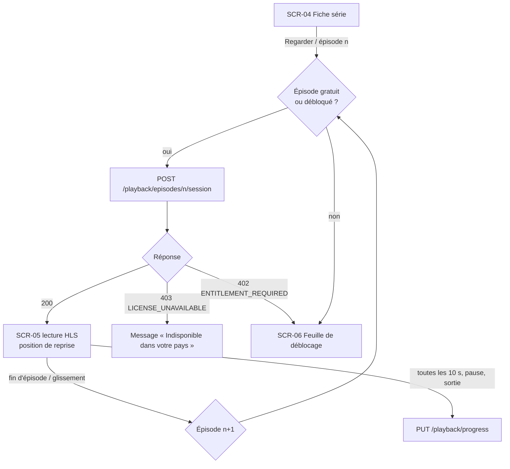

| Erreur | Réponse |
|---|---|
| URL expirée en cours de lecture | Nouvelle session demandée automatiquement, reprise à la position courante |
| Réseau coupé | Mise en pause + indicateur ; reprise automatique au retour du réseau |
| Lecture impossible (codec, erreur CDN) | Message + « Réessayer » ; événement `playback_error` envoyé |
| Licence expirée entre-temps | 403 → message, retour à la fiche |

**Résultat** : progression sauvegardée (connecté) ou locale (anonyme, fusionnée au login).

### FLOW-07 — Déblocage d'un épisode (FR-MON-002, 003, 004)

**Entrée** : épisode payant non débloqué ; SCR-06 affiche le prix (ex. 15 crédits) et le solde.

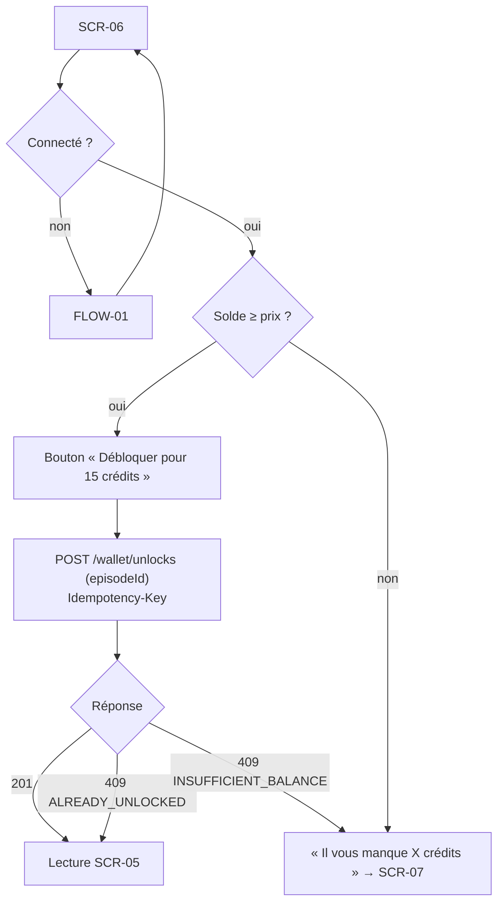

Règles serveur (transaction unique) : verrou du portefeuille, vérification du solde, écriture de débit (bonus d'abord), création de l'`entitlement`. Un double tap envoie la même `Idempotency-Key` → un seul débit.

**Option** « déblocage automatique » (FR-MON-004) : si activée et solde suffisant, l'épisode suivant est débloqué à l'enchaînement, avec un toast « 15 crédits utilisés · Annuler (5 s) » ; l'annulation rembourse les crédits si la lecture n'a pas dépassé 5 s.

### FLOW-08 — Achat de crédits et paiement (FR-PAY-001..008, 011)

**Entrée** : connecté sur le web/PWA ; SCR-07 liste les packs de la marque dans la devise du pays de l'utilisateur (Sénégal : XOF ; Gambie au lancement : XOF, carte uniquement). Dans les applications store, voir FLOW-17.

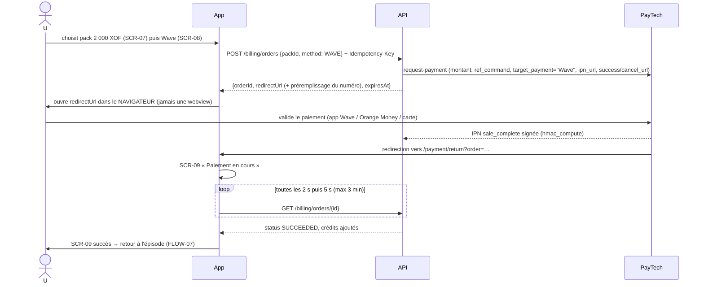

| Cas | Comportement |
|---|---|
| Redirection « succès » mais commande encore `PENDING` | SCR-09 reste « en cours » ; **aucun crédit** tant que le serveur n'a pas confirmé |
| Paiement refusé (solde insuffisant, annulation) | SCR-09 échec avec motif lisible + « Réessayer » / « Autre moyen » |
| L'utilisateur ferme l'app | À la réouverture, bannière « Paiement de 2 000 XOF en cours / confirmé » (commandes récentes non vues) |
| Commande expirée (30 min) | Statut `EXPIRED` ; si le fournisseur confirme plus tard, crédit automatique + notification |
| Fournisseur indisponible à la création | `503 PROVIDER_UNAVAILABLE` → proposer un autre moyen |
| Double clic sur « Payer » | Même `Idempotency-Key` → même commande |

**Résultat** : commande `SUCCEEDED`, écriture de crédit unique, notification in-app, reçu dans SCR-15.

### FLOW-09 — Portefeuille et historique (FR-MON-002, FR-PAY-008)

SCR-15 : solde (payés / bonus avec expiration), relevé paginé des mouvements (achat, déblocage, bonus, ajustement support, remboursement), liste des achats avec reçu. Aucune action destructive possible côté utilisateur.

### FLOW-10 — Profil et réglages (FR-AUTH-006, 007)

SCR-14 : nom affiché, langue, pays (affiché, modifiable seulement si la marque ouvre plusieurs pays — le pays de facturation suit le numéro), qualité vidéo / économie de données, sous-titres par défaut, déblocage automatique, déconnexion, déconnexion de tous les appareils, **supprimer mon compte** (double confirmation + OTP ; informe que les crédits restants seront perdus et que les écritures financières anonymisées sont conservées), liens CGU/confidentialité de la marque.

### FLOW-11 — Favoris, continuer à regarder, notifications (FR-LIB-*, FR-NOTIF-002, 003)

- Cœur sur SCR-04/SCR-05 → `PUT /library/favorites/{seriesId}` (non connecté → FLOW-01 puis action rejouée).
- SCR-13 : onglets « Continuer » / « Ma liste ».
- SCR-16 : nouvel épisode d'une série favorite, confirmation/échec de paiement, crédits bonus reçus ; marquer comme lu.

### FLOW-12 — Gestion des erreurs, états vides, connexion instable (transverse)

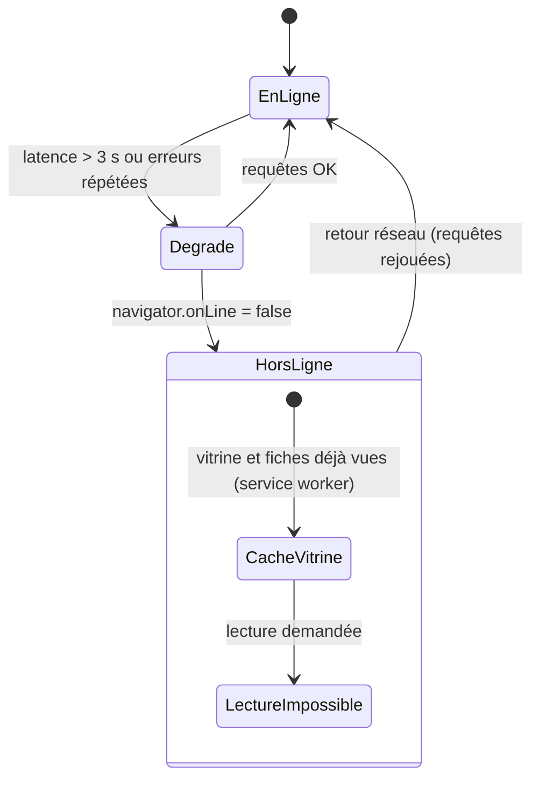

Règles : toute action d'écriture échouée hors ligne est **mise en file** (favoris, progression) sauf paiement et déblocage (jamais rejoués automatiquement). Codes d'erreur API traduits côté client depuis le catalogue (`error.code`).

## 3. Flux back-office

### FLOW-13 — Publication d'une série (plateforme) (FR-ADM-001..005, FR-CAT-007)

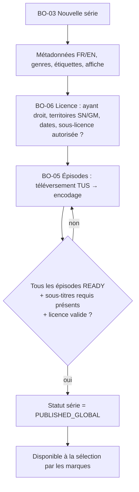

Erreurs : téléversement interrompu → reprise TUS ; encodage échoué → statut `FAILED` + relance ; licence sans territoire → publication bloquée (`LICENSE_INCOMPLETE`).

### FLOW-13b — Import en lot du catalogue (FR-ADM-009)

**Entrée** : gestionnaire de contenu plateforme ; masters déjà déposés dans le bucket de dépôt ; licence de la série saisie.

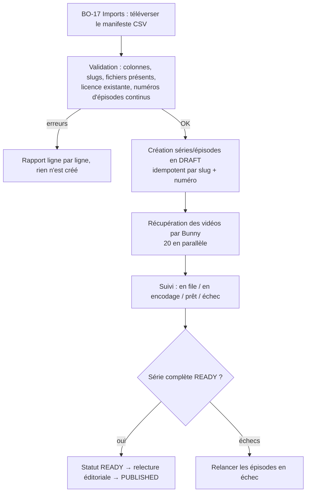

**Résultat** : une série de 60 épisodes est importée sans aucun téléversement manuel ; l'import peut être relancé sans créer de doublons.

### FLOW-14 — Configuration d'une marque (FR-TEN-001..006)

1. Super-admin (BO-12) : crée la marque (nom, slug, raison sociale, pays ouverts, devises, langues, taux de reversement).
2. BO-13 : domaines → instructions DNS (CNAME vers l'ingress) → vérification → certificat TLS (CapRover/Let's Encrypt).
3. Branding : logo, icône, couleurs (contraste contrôlé automatiquement), police parmi une liste, textes légaux.
4. Moyens de paiement : activation par pays parmi les comptes fournisseurs de la plateforme (BO-16).
5. Admin marque invité (OTP e-mail) → BO-11 : sélectionne les séries (pour une marque tierce, seules celles dont la licence autorise la sous-licence et couvre un de ses pays sont proposées ; pour la marque maison, toutes les séries licenciées sur ses pays), fixe épisodes gratuits et prix en crédits, crée les packs par devise.
6. BO-10 : compose les rangées d'accueil et bannières.
7. Passage en `ACTIVE` (contrôle : au moins 1 série, 1 pack par devise ouverte, 1 moyen de paiement par pays, CGU publiées).

### FLOW-15 — Support utilisateur (FR-ADM-006)

Recherche par numéro (masqué partiellement à l'affichage) → fiche membre (dans la marque courante uniquement pour un rôle marque) → achats, solde, déblocages → action « Ajuster les crédits » (montant, motif obligatoire, crédits bonus uniquement) → écriture de grand livre `ADJUSTMENT` + audit.

### FLOW-16 — Remboursement et rapprochement (FR-PAY-009, 010)

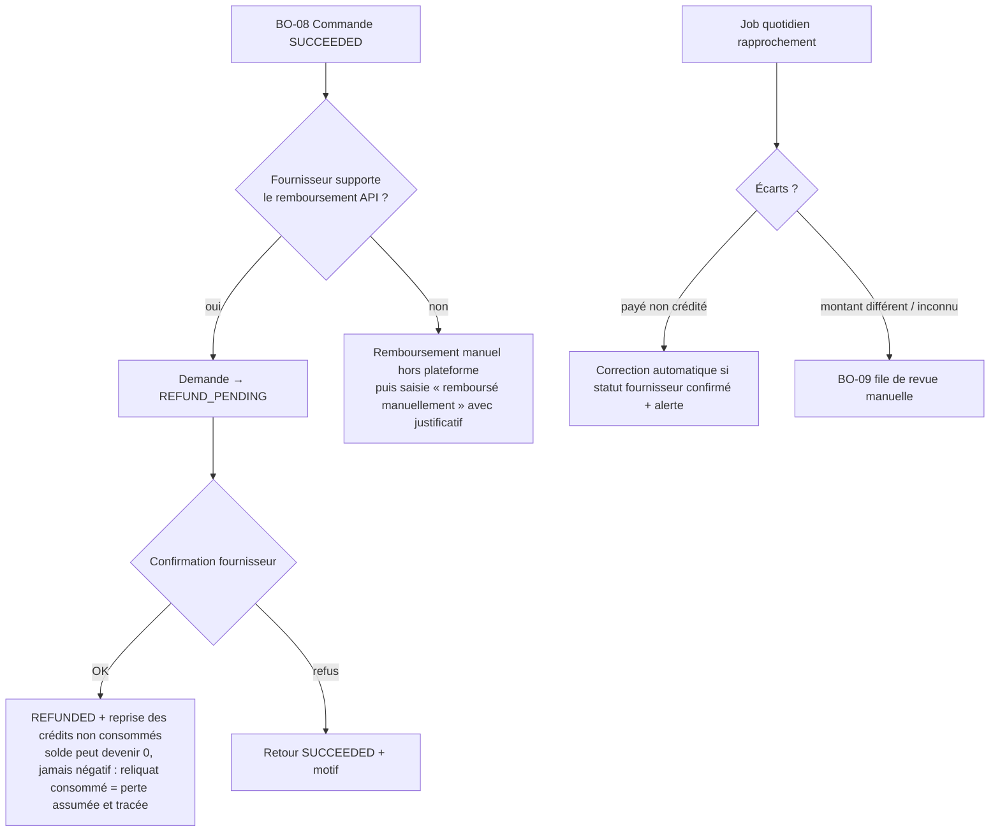

### FLOW-17 — Achat de crédits dans l'application store (phase 2, FR-PAY-012, 013, 014)

**Entrée** : application Android ou iOS de la marque, utilisateur connecté.

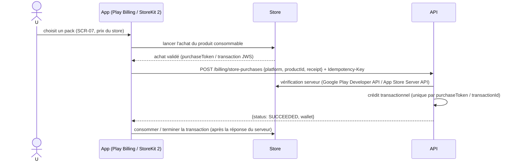

| Cas | Comportement |
|---|---|
| Application fermée avant l'appel serveur | Au redémarrage, l'app relit les achats non terminés et les renvoie (idempotent) |
| Reçu invalide ou produit inconnu | `422 STORE_RECEIPT_INVALID` ; aucun crédit ; alerte si répété |
| Remboursement accordé par le store | Notification serveur → `REFUND_REVERSAL` (FLOW-16) |
| Crédits achetés sur le web | Visibles et utilisables dans l'app ; l'app ne mentionne jamais le web comme moyen d'achat |

## 4. Transitions d'état de référence

| Objet | États | Document |
|---|---|---|
| Commande | CREATED, PENDING, SUCCEEDED, FAILED, CANCELLED, EXPIRED, REFUND_PENDING, REFUNDED | 02-TRD §8.3 |
| Média | PENDING_UPLOAD, UPLOADING, PROCESSING, READY, FAILED, DELETED | 05-BACKEND-SCHEMA |
| Série (globale) | DRAFT, READY, PUBLISHED, ARCHIVED | 05-BACKEND-SCHEMA |
| Série (marque) | HIDDEN, SCHEDULED, LIVE | 05-BACKEND-SCHEMA |
| Marque | DRAFT, ACTIVE, SUSPENDED, ARCHIVED | 05-BACKEND-SCHEMA |
