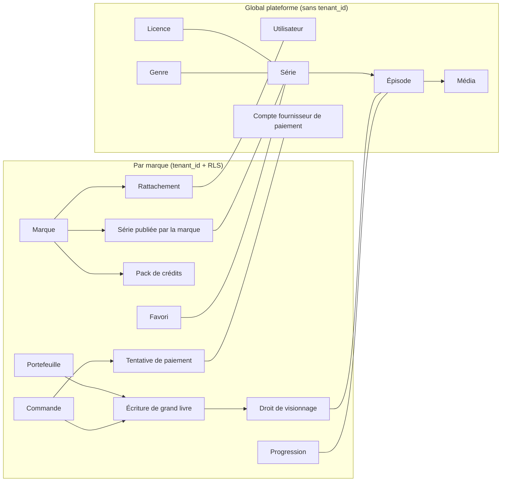
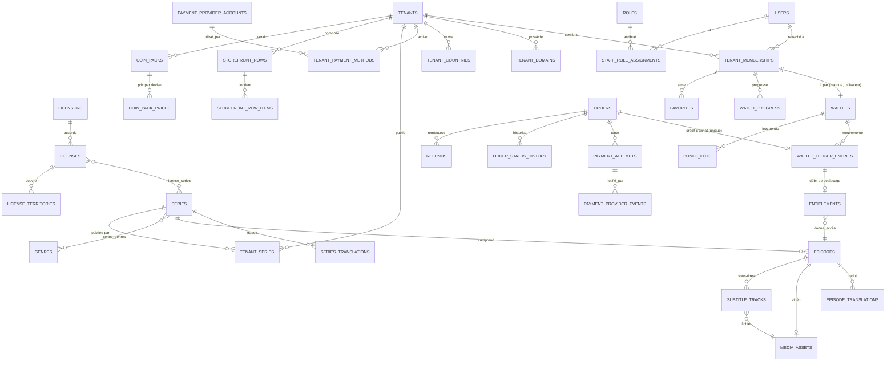
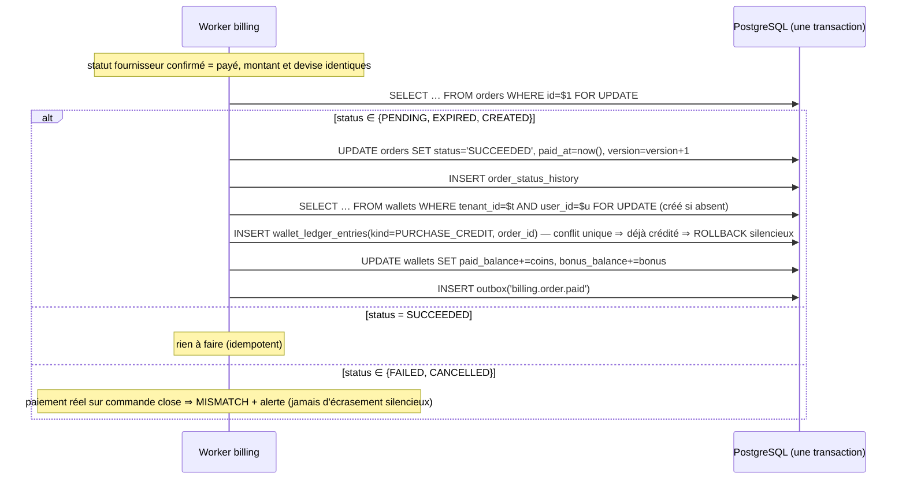

# 05 — BACKEND SCHEMA · Modèle de données

| | |
|---|---|
| Version | 0.2 — **brouillon soumis à validation** (0.2 : marque maison, licences sans sous-licence par défaut, produits store, imports en lot, Gambie en XOF) |
| Date | 2026-10-19 |
| SGBD | PostgreSQL 16 · ORM Prisma 6 (derrière des ports, ADR-0006 du socle) |
| Références | [02-TRD §4 et §8](02-TRD.md) · [01-PRD](01-PRD.md) |

Conventions héritées du socle : clés `uuid` (v7 générées par l'application pour l'ordre d'insertion), colonnes `snake_case`, `created_at`/`updated_at` en `timestamptz`, suppression logique `deleted_at` là où un historique est requis, montants en `bigint` d'unités mineures, **aucun `float`/`numeric` pour l'argent**.

---

## 1. Modèle conceptuel



Règle fondamentale : **identité et catalogue sont globaux ; tout ce qui concerne l'argent, les droits et le comportement d'un utilisateur appartient à une marque.**

## 2. Diagramme entité-association (modèle logique)



## 3. Stratégie d'isolation

| Catégorie | Tables | Mécanisme |
|---|---|---|
| Globales (référentiel) | `currencies`, `countries`, `genres`, `genre_translations` | Lecture libre, écriture rôle plateforme |
| Globales (sensibles) | `users`, `auth_challenges`, `auth_sessions`, `staff_role_assignments`, `payment_provider_accounts` | Accès restreint au module `identity` / `billing` (règle dependency-cruiser) ; pas de RLS tenant |
| Globales (catalogue) | `series*`, `episodes*`, `media_assets`, `subtitle_tracks`, `licensors`, `licenses*` | Lecture via façade `catalog` ; écriture rôles plateforme |
| **Tenant** | toutes les tables portant `tenant_id NOT NULL` | Extension Prisma (injection `tenant_id`) **+** RLS `ENABLE` + `FORCE`, politique `tenant_isolation` générée par `rls-policies.sql` (socle) |
| Tenant nullable | `payment_provider_events`, `audit_logs`, `reconciliation_items` | Politique : `tenant_id = app_current_tenant()` **ou** `app_bypass_rls()` (chemin `$privileged` journalisé, réservé aux workers et rôles plateforme) |

Vue d'accès aux membres pour les rôles marque :

```sql
CREATE VIEW tenant_members_v WITH (security_barrier = true, security_invoker = true) AS
SELECT m.tenant_id, m.user_id, m.status, m.created_at AS joined_at,
       u.display_name, u.phone_e164, u.country_code, u.locale, u.last_login_at
FROM tenant_memberships m
JOIN users u ON u.id = m.user_id AND u.deleted_at IS NULL;
-- security_invoker : la RLS de tenant_memberships s'applique avec le rôle appelant.
```

## 4. Tables globales

### 4.1 Référentiels

```sql
-- Repris du socle. La colonne rate_to_xof du socle est SUPPRIMÉE : aucune conversion implicite (NFR-MONEY-001).
CREATE TABLE currencies (
  code      char(3) PRIMARY KEY,          -- 'XOF', 'GMD' ; 'USD' pour le reporting des achats store (phase 2)
  name      text    NOT NULL,
  symbol    text    NOT NULL,             -- 'FCFA', 'D'
  decimals  smallint NOT NULL CHECK (decimals BETWEEN 0 AND 3)  -- XOF=0, GMD=2
);
CREATE TABLE countries (
  code          char(2) PRIMARY KEY,      -- 'SN', 'GM'
  name_fr       text NOT NULL,
  name_en       text NOT NULL,
  dial_code     text NOT NULL,            -- '+221'
  currency_code char(3) NOT NULL REFERENCES currencies(code),
  default_locale text NOT NULL,           -- 'fr', 'en'
  is_active     boolean NOT NULL DEFAULT true
);
```

### 4.2 Identité

```sql
CREATE TYPE user_status AS ENUM ('ACTIVE','BLOCKED','DELETED');
CREATE TABLE users (
  id                uuid PRIMARY KEY,
  phone_e164        text UNIQUE,                         -- NULL après effacement
  email             citext UNIQUE,
  display_name      text,
  locale            text NOT NULL DEFAULT 'fr' CHECK (locale IN ('fr','en')),
  country_code      char(2) REFERENCES countries(code),
  status            user_status NOT NULL DEFAULT 'ACTIVE',
  phone_verified_at timestamptz,
  email_verified_at timestamptz,
  mfa_totp_secret_enc bytea,                             -- staff uniquement, chiffré
  last_login_at     timestamptz,
  created_at        timestamptz NOT NULL DEFAULT now(),
  updated_at        timestamptz NOT NULL DEFAULT now(),
  deleted_at        timestamptz,
  CHECK (phone_e164 IS NOT NULL OR email IS NOT NULL OR status = 'DELETED')
);

-- Repris du socle (auth_challenges, auth_sessions) avec ces différences :
--   auth_challenges.tenant_id  uuid NULL  -> marque d'origine (gabarit SMS, quotas)
--   auth_sessions.tenant_id    uuid NULL  -> NULL = session back-office plateforme
--   auth_sessions.audience     text NOT NULL CHECK (audience IN ('APP','BACKOFFICE'))

CREATE TABLE roles (
  id uuid PRIMARY KEY, code text UNIQUE NOT NULL,      -- 'PLATFORM_SUPER_ADMIN', 'TENANT_ADMIN', …
  scope text NOT NULL CHECK (scope IN ('PLATFORM','TENANT'))
);
CREATE TABLE staff_role_assignments (
  id uuid PRIMARY KEY,
  user_id   uuid NOT NULL REFERENCES users(id),
  role_id   uuid NOT NULL REFERENCES roles(id),
  tenant_id uuid NULL REFERENCES tenants(id),            -- NULL ⇔ rôle de scope PLATFORM (trigger de contrôle)
  granted_by uuid NOT NULL REFERENCES users(id),
  created_at timestamptz NOT NULL DEFAULT now(),
  revoked_at timestamptz,
  UNIQUE NULLS NOT DISTINCT (user_id, role_id, tenant_id)
);
```

### 4.3 Marques et paiement (configuration)

```sql
CREATE TYPE tenant_status AS ENUM ('DRAFT','ACTIVE','SUSPENDED','ARCHIVED');
CREATE TABLE tenants (                                   -- repris du socle, enrichi
  id uuid PRIMARY KEY,
  slug text UNIQUE NOT NULL CHECK (slug ~ '^[a-z0-9-]{3,40}$'),
  name text NOT NULL,
  legal_name text,
  status tenant_status NOT NULL DEFAULT 'DRAFT',
  isolation text NOT NULL DEFAULT 'SHARED_RLS',
  default_locale text NOT NULL DEFAULT 'fr',
  timezone text NOT NULL DEFAULT 'Africa/Dakar',
  branding jsonb NOT NULL DEFAULT '{}',                  -- validé par schéma Zod : accent, logo, icône, police
  legal_docs jsonb NOT NULL DEFAULT '{}',                -- versions CGU/confidentialité par langue
  is_first_party boolean NOT NULL DEFAULT false,         -- marque maison (D-13) ; au plus une ligne à true (index unique partiel)
  revenue_share_bps integer NULL CHECK (revenue_share_bps BETWEEN 0 AND 10000),  -- NULL tant que le contrat n'est pas signé (Q-12)
  app_public_key text UNIQUE,                            -- résolveur 'app-key' (mobile)
  settings jsonb NOT NULL DEFAULT '{}',
  created_at timestamptz NOT NULL DEFAULT now(), updated_at timestamptz NOT NULL DEFAULT now(),
  deleted_at timestamptz
);
CREATE UNIQUE INDEX one_first_party_tenant ON tenants ((true)) WHERE is_first_party;
CREATE TABLE tenant_domains (                            -- repris du socle
  id uuid PRIMARY KEY, tenant_id uuid NOT NULL REFERENCES tenants(id),
  domain citext UNIQUE NOT NULL, is_primary boolean NOT NULL DEFAULT false,
  verification_token text NOT NULL, verified_at timestamptz,
  created_at timestamptz NOT NULL DEFAULT now()
);
CREATE TABLE tenant_countries (
  tenant_id uuid NOT NULL REFERENCES tenants(id),
  country_code char(2) NOT NULL REFERENCES countries(code),
  currency_code char(3) NOT NULL REFERENCES currencies(code),  -- GM = 'XOF' au lancement (D-12), 'GMD' ensuite
  tax_rate_bps integer NOT NULL DEFAULT 0,               -- [À CONFIRMER] comptable
  prices_tax_inclusive boolean NOT NULL DEFAULT true,
  enabled boolean NOT NULL DEFAULT true,
  PRIMARY KEY (tenant_id, country_code)
);

CREATE TYPE payment_provider AS ENUM ('PAYTECH','WAVE','PAYDUNYA','ORANGE_MONEY','GOOGLE_PLAY','APP_STORE','FAKE');
CREATE TABLE payment_provider_accounts (                -- GLOBAL : comptes marchands de la plateforme (D-07)
  id uuid PRIMARY KEY,
  provider payment_provider NOT NULL,
  label text NOT NULL,                                   -- 'Wave Business SN — prod'
  country_code char(2) NOT NULL REFERENCES countries(code),
  currency_code char(3) NOT NULL REFERENCES currencies(code),
  environment text NOT NULL CHECK (environment IN ('TEST','LIVE')),
  credentials_enc bytea NOT NULL,                        -- AES-256-GCM, clé maîtresse hors base
  webhook_path_key text UNIQUE NOT NULL,                 -- segment aléatoire de l'URL de webhook
  owner_tenant_id uuid NULL REFERENCES tenants(id),      -- compte propre d'une marque : FR-TEN-008 (L) et comptes store des marques tierces (TRD §16.4)
  status text NOT NULL DEFAULT 'ACTIVE',
  created_at timestamptz NOT NULL DEFAULT now()
);
CREATE TABLE tenant_payment_methods (                    -- RLS tenant
  id uuid PRIMARY KEY,
  tenant_id uuid NOT NULL REFERENCES tenants(id),
  country_code char(2) NOT NULL,
  method text NOT NULL CHECK (method IN ('WAVE','ORANGE_MONEY','FREE_MONEY','CARD')),
  provider_account_id uuid NOT NULL REFERENCES payment_provider_accounts(id),
  priority smallint NOT NULL DEFAULT 0,                  -- 1er compte actif utilisé ; bascule = changer la priorité
  enabled boolean NOT NULL DEFAULT true,
  UNIQUE (tenant_id, country_code, method, provider_account_id),
  FOREIGN KEY (tenant_id, country_code) REFERENCES tenant_countries(tenant_id, country_code)
);
```

### 4.4 Catalogue, médias, licences

```sql
CREATE TYPE series_status AS ENUM ('DRAFT','READY','PUBLISHED','ARCHIVED');
CREATE TABLE series (
  id uuid PRIMARY KEY,
  slug text UNIQUE NOT NULL,
  original_locale text NOT NULL,
  status series_status NOT NULL DEFAULT 'DRAFT',
  free_episodes_default smallint NOT NULL DEFAULT 5 CHECK (free_episodes_default >= 0),
  episode_price_coins_default integer NOT NULL DEFAULT 15 CHECK (episode_price_coins_default > 0),
  poster_asset_id uuid REFERENCES media_assets(id),
  banner_asset_id uuid REFERENCES media_assets(id),
  trailer_asset_id uuid REFERENCES media_assets(id),
  maturity_rating text NOT NULL DEFAULT '13+',
  published_at timestamptz,
  created_at timestamptz NOT NULL DEFAULT now(), updated_at timestamptz NOT NULL DEFAULT now(),
  deleted_at timestamptz
);
CREATE TABLE series_translations (
  series_id uuid NOT NULL REFERENCES series(id) ON DELETE CASCADE,
  locale text NOT NULL CHECK (locale IN ('fr','en')),
  title text NOT NULL, synopsis text NOT NULL DEFAULT '',
  search_document tsvector GENERATED ALWAYS AS (
    to_tsvector('simple', immutable_unaccent(coalesce(title,'') || ' ' || coalesce(synopsis,'')))
  ) STORED,
  PRIMARY KEY (series_id, locale)
);
CREATE INDEX series_tr_search_gin ON series_translations USING gin (search_document);
CREATE INDEX series_tr_title_trgm ON series_translations USING gin (immutable_unaccent(title) gin_trgm_ops);

CREATE TABLE genres (id uuid PRIMARY KEY, slug text UNIQUE NOT NULL);
CREATE TABLE genre_translations (genre_id uuid REFERENCES genres(id), locale text, name text NOT NULL, PRIMARY KEY (genre_id, locale));
CREATE TABLE series_genres (series_id uuid REFERENCES series(id), genre_id uuid REFERENCES genres(id), PRIMARY KEY (series_id, genre_id));

CREATE TYPE episode_status AS ENUM ('DRAFT','READY','PUBLISHED','WITHDRAWN');
CREATE TABLE episodes (
  id uuid PRIMARY KEY,
  series_id uuid NOT NULL REFERENCES series(id),
  number smallint NOT NULL CHECK (number > 0),
  status episode_status NOT NULL DEFAULT 'DRAFT',
  video_asset_id uuid REFERENCES media_assets(id),
  duration_seconds integer CHECK (duration_seconds > 0),
  price_coins_override integer CHECK (price_coins_override > 0),
  created_at timestamptz NOT NULL DEFAULT now(), updated_at timestamptz NOT NULL DEFAULT now(),
  UNIQUE (series_id, number),
  CHECK (status <> 'PUBLISHED' OR video_asset_id IS NOT NULL)
);
CREATE TABLE episode_translations (episode_id uuid REFERENCES episodes(id) ON DELETE CASCADE, locale text, title text NOT NULL, PRIMARY KEY (episode_id, locale));

CREATE TYPE media_kind AS ENUM ('VIDEO','IMAGE','SUBTITLE');
CREATE TYPE media_status AS ENUM ('PENDING_UPLOAD','UPLOADING','PROCESSING','READY','FAILED','DELETED');
CREATE TABLE media_assets (
  id uuid PRIMARY KEY,
  kind media_kind NOT NULL,
  provider text NOT NULL CHECK (provider IN ('BUNNY_STREAM','S3')),
  provider_ref text NOT NULL,                            -- GUID Bunny ou clé S3
  status media_status NOT NULL DEFAULT 'PENDING_UPLOAD',
  mime_type text, size_bytes bigint, width integer, height integer, duration_ms integer,
  renditions jsonb NOT NULL DEFAULT '[]',                -- ex. ["240p","360p","480p","720p"]
  failure_reason text,
  created_by uuid REFERENCES users(id),
  created_at timestamptz NOT NULL DEFAULT now(), updated_at timestamptz NOT NULL DEFAULT now(),
  UNIQUE (provider, provider_ref)
);
CREATE TABLE subtitle_tracks (
  episode_id uuid NOT NULL REFERENCES episodes(id) ON DELETE CASCADE,
  locale text NOT NULL CHECK (locale IN ('fr','en')),
  asset_id uuid NOT NULL REFERENCES media_assets(id),
  PRIMARY KEY (episode_id, locale)
);

CREATE TABLE licensors (id uuid PRIMARY KEY, name text NOT NULL, contact jsonb NOT NULL DEFAULT '{}');
CREATE TABLE licenses (
  id uuid PRIMARY KEY,
  licensor_id uuid NOT NULL REFERENCES licensors(id),
  contract_ref text NOT NULL,
  contract_document_key text,                            -- clé S3 du contrat signé (bucket privé)
  starts_at timestamptz NOT NULL,
  ends_at timestamptz NOT NULL CHECK (ends_at > starts_at),
  sublicensing_allowed boolean NOT NULL DEFAULT false,   -- diffusion par des marques tierces (R-02, D-13)
  CHECK (NOT sublicensing_allowed OR contract_document_key IS NOT NULL),  -- pas de sous-licence sans contrat joint
  drm_required boolean NOT NULL DEFAULT false,
  allowed_locales text[] NOT NULL DEFAULT '{fr,en}',
  notes text,
  created_at timestamptz NOT NULL DEFAULT now()
);
CREATE TABLE license_territories (license_id uuid REFERENCES licenses(id) ON DELETE CASCADE, country_code char(2) REFERENCES countries(code), PRIMARY KEY (license_id, country_code));
CREATE TABLE license_series (license_id uuid REFERENCES licenses(id), series_id uuid REFERENCES series(id), PRIMARY KEY (license_id, series_id));
```

Disponibilité d'une série pour (marque, pays, instant) — fonction SQL stable utilisée par la vitrine et la lecture :

```sql
CREATE FUNCTION series_available(p_series uuid, p_country char(2), p_at timestamptz, p_third_party boolean)
RETURNS boolean LANGUAGE sql STABLE AS $$
  SELECT EXISTS (
    SELECT 1 FROM license_series ls
    JOIN licenses l ON l.id = ls.license_id
    JOIN license_territories lt ON lt.license_id = l.id
    WHERE ls.series_id = p_series AND lt.country_code = p_country
      AND p_at >= l.starts_at AND p_at < l.ends_at
      AND (NOT p_third_party OR l.sublicensing_allowed)
  );
$$;
-- Appel : p_third_party = NOT tenants.is_first_party (marque maison : pas d'exigence de sous-licence).
```

### 4.5 Imports en lot (FR-ADM-009)

```sql
CREATE TABLE catalog_imports (
  id uuid PRIMARY KEY,
  manifest_key text NOT NULL,                            -- CSV dans le bucket de dépôt
  status text NOT NULL CHECK (status IN ('VALIDATING','REJECTED','RUNNING','COMPLETED','COMPLETED_WITH_ERRORS')),
  stats jsonb NOT NULL DEFAULT '{}',                     -- totaux par statut
  created_by uuid NOT NULL REFERENCES users(id),
  created_at timestamptz NOT NULL DEFAULT now(), finished_at timestamptz
);
CREATE TABLE catalog_import_items (
  id uuid PRIMARY KEY,
  import_id uuid NOT NULL REFERENCES catalog_imports(id),
  series_slug text NOT NULL, episode_number smallint,    -- NULL = ligne série
  source_key text,                                       -- fichier master dans le bucket de dépôt
  episode_id uuid REFERENCES episodes(id),
  status text NOT NULL CHECK (status IN ('PENDING','FETCHING','ENCODING','READY','FAILED','SKIPPED')),
  error text, attempts smallint NOT NULL DEFAULT 0,
  UNIQUE (import_id, series_slug, episode_number)
);
-- Idempotence entre imports : episodes (series_id, number) est déjà unique ; une ligne déjà READY est SKIPPED.
```

## 5. Tables par marque (RLS)

Toutes ont `tenant_id uuid NOT NULL REFERENCES tenants(id)` en première colonne de leurs index composites.

### 5.1 Rattachements, vitrine, prix

```sql
CREATE TABLE tenant_memberships (
  tenant_id uuid NOT NULL, user_id uuid NOT NULL REFERENCES users(id),
  status text NOT NULL DEFAULT 'ACTIVE' CHECK (status IN ('ACTIVE','BLOCKED','LEFT')),
  terms_version text NOT NULL, terms_accepted_at timestamptz NOT NULL,
  preferences jsonb NOT NULL DEFAULT '{}',              -- qualité, sous-titres, auto-déblocage
  created_at timestamptz NOT NULL DEFAULT now(),
  PRIMARY KEY (tenant_id, user_id)
);

CREATE TYPE tenant_series_status AS ENUM ('HIDDEN','SCHEDULED','LIVE');
CREATE TABLE tenant_series (
  tenant_id uuid NOT NULL, series_id uuid NOT NULL REFERENCES series(id),
  status tenant_series_status NOT NULL DEFAULT 'HIDDEN',
  live_from timestamptz,
  free_episodes_override smallint CHECK (free_episodes_override >= 0),
  episode_price_coins_override integer CHECK (episode_price_coins_override > 0),
  created_at timestamptz NOT NULL DEFAULT now(), updated_at timestamptz NOT NULL DEFAULT now(),
  PRIMARY KEY (tenant_id, series_id),
  CHECK (status <> 'SCHEDULED' OR live_from IS NOT NULL)
);
CREATE TABLE tenant_episode_prices (                     -- surcharge fine (S)
  tenant_id uuid NOT NULL, episode_id uuid NOT NULL REFERENCES episodes(id),
  price_coins integer NOT NULL CHECK (price_coins >= 0), -- 0 = rendu gratuit par la marque
  PRIMARY KEY (tenant_id, episode_id)
);

CREATE TABLE storefront_rows (
  id uuid PRIMARY KEY, tenant_id uuid NOT NULL,
  kind text NOT NULL CHECK (kind IN ('FEATURED','CONTINUE','NEW','POPULAR','GENRE','CURATED')),
  titles jsonb NOT NULL DEFAULT '{}',                    -- {"fr": "...", "en": "..."}
  genre_id uuid REFERENCES genres(id),
  position smallint NOT NULL, active boolean NOT NULL DEFAULT true,
  UNIQUE (tenant_id, position)
);
CREATE TABLE storefront_row_items (
  tenant_id uuid NOT NULL, row_id uuid NOT NULL REFERENCES storefront_rows(id) ON DELETE CASCADE,
  series_id uuid NOT NULL, position smallint NOT NULL,
  PRIMARY KEY (row_id, series_id),
  FOREIGN KEY (tenant_id, series_id) REFERENCES tenant_series(tenant_id, series_id)
);

CREATE TABLE coin_packs (
  id uuid PRIMARY KEY, tenant_id uuid NOT NULL,
  code text NOT NULL, coins integer NOT NULL CHECK (coins > 0),
  bonus_coins integer NOT NULL DEFAULT 0 CHECK (bonus_coins >= 0),
  badge text, position smallint NOT NULL DEFAULT 0, active boolean NOT NULL DEFAULT true,
  UNIQUE (tenant_id, code)
);
CREATE TABLE coin_pack_prices (
  tenant_id uuid NOT NULL, coin_pack_id uuid NOT NULL REFERENCES coin_packs(id),
  currency_code char(3) NOT NULL REFERENCES currencies(code),
  amount_minor bigint NOT NULL CHECK (amount_minor > 0),
  PRIMARY KEY (coin_pack_id, currency_code)
);
CREATE TABLE coin_pack_store_products (                  -- phase 2 (TRD §16.3)
  tenant_id uuid NOT NULL, coin_pack_id uuid NOT NULL REFERENCES coin_packs(id),
  platform text NOT NULL CHECK (platform IN ('GOOGLE_PLAY','APP_STORE')),
  product_id text NOT NULL,                              -- identifiant du produit consommable dans la console du store
  active boolean NOT NULL DEFAULT true,
  PRIMARY KEY (coin_pack_id, platform),
  UNIQUE (tenant_id, platform, product_id)
);
```

### 5.2 Portefeuille, grand livre, droits

```sql
CREATE TABLE wallets (
  id uuid PRIMARY KEY, tenant_id uuid NOT NULL, user_id uuid NOT NULL,
  paid_balance  integer NOT NULL DEFAULT 0 CHECK (paid_balance  >= 0),
  bonus_balance integer NOT NULL DEFAULT 0 CHECK (bonus_balance >= 0),
  version bigint NOT NULL DEFAULT 0,
  updated_at timestamptz NOT NULL DEFAULT now(),
  UNIQUE (tenant_id, user_id),
  FOREIGN KEY (tenant_id, user_id) REFERENCES tenant_memberships(tenant_id, user_id)
);

CREATE TYPE ledger_kind AS ENUM (
  'PURCHASE_CREDIT',    -- crédits d'un pack payé (+paid, +bonus éventuel)
  'UNLOCK_DEBIT',       -- déblocage d'épisode (-bonus d'abord, puis -paid)
  'UNLOCK_CANCEL',      -- annulation d'un déblocage automatique (< 5 s)
  'BONUS_GRANT', 'BONUS_EXPIRE',
  'ADJUSTMENT',         -- support, bonus uniquement, motif obligatoire
  'REFUND_REVERSAL'     -- reprise des crédits non consommés lors d'un remboursement
);
CREATE TABLE wallet_ledger_entries (
  id uuid PRIMARY KEY, tenant_id uuid NOT NULL,
  wallet_id uuid NOT NULL REFERENCES wallets(id),
  kind ledger_kind NOT NULL,
  paid_delta integer NOT NULL, bonus_delta integer NOT NULL,
  paid_balance_after integer NOT NULL CHECK (paid_balance_after >= 0),
  bonus_balance_after integer NOT NULL CHECK (bonus_balance_after >= 0),
  order_id uuid REFERENCES orders(id),
  refund_id uuid REFERENCES refunds(id),
  episode_id uuid REFERENCES episodes(id),
  reverses_entry_id uuid REFERENCES wallet_ledger_entries(id),
  idempotency_key text,
  reason text, actor_user_id uuid, actor_type text NOT NULL DEFAULT 'USER',
  created_at timestamptz NOT NULL DEFAULT now(),
  CHECK (kind <> 'PURCHASE_CREDIT' OR order_id IS NOT NULL),
  CHECK (kind <> 'UNLOCK_DEBIT'    OR episode_id IS NOT NULL),
  CHECK (kind <> 'ADJUSTMENT'      OR (reason IS NOT NULL AND paid_delta = 0)),
  CHECK (paid_delta <> 0 OR bonus_delta <> 0)
);
-- Un achat ne crédite qu'une fois, quel que soit le nombre de notifications :
CREATE UNIQUE INDEX ledger_one_credit_per_order ON wallet_ledger_entries (order_id) WHERE kind = 'PURCHASE_CREDIT';
-- Un double tap ne débite qu'une fois :
CREATE UNIQUE INDEX ledger_idem ON wallet_ledger_entries (wallet_id, idempotency_key) WHERE idempotency_key IS NOT NULL;
CREATE INDEX ledger_wallet_time ON wallet_ledger_entries (tenant_id, wallet_id, created_at DESC);
-- Immuabilité : trigger BEFORE UPDATE OR DELETE → RAISE EXCEPTION (les corrections sont de nouvelles écritures).

CREATE TABLE bonus_lots (                                -- (S) FR-MON-006 : consommation FIFO par expiration
  id uuid PRIMARY KEY, tenant_id uuid NOT NULL, wallet_id uuid NOT NULL REFERENCES wallets(id),
  granted_entry_id uuid NOT NULL REFERENCES wallet_ledger_entries(id),
  amount integer NOT NULL CHECK (amount > 0),
  remaining integer NOT NULL CHECK (remaining BETWEEN 0 AND amount),
  expires_at timestamptz,
  created_at timestamptz NOT NULL DEFAULT now()
);

CREATE TYPE entitlement_source AS ENUM ('COINS','ADMIN_GRANT','PROMO','SUBSCRIPTION');
CREATE TABLE entitlements (
  id uuid PRIMARY KEY, tenant_id uuid NOT NULL, user_id uuid NOT NULL,
  episode_id uuid NOT NULL REFERENCES episodes(id),
  source entitlement_source NOT NULL,
  ledger_entry_id uuid UNIQUE REFERENCES wallet_ledger_entries(id),
  granted_at timestamptz NOT NULL DEFAULT now(),
  revoked_at timestamptz, revoke_reason text,
  UNIQUE (tenant_id, user_id, episode_id),
  CHECK (source <> 'COINS' OR ledger_entry_id IS NOT NULL),
  FOREIGN KEY (tenant_id, user_id) REFERENCES tenant_memberships(tenant_id, user_id)
);
```

> Les épisodes **gratuits** ne créent pas d'`entitlement` : la gratuité est calculée (numéro ≤ nombre gratuit effectif, ou prix effectif = 0). Cela permet à une marque de modifier le nombre d'épisodes gratuits sans migration de données.

### 5.3 Commandes et paiements

```sql
CREATE TYPE order_status AS ENUM ('CREATED','PENDING','SUCCEEDED','FAILED','CANCELLED','EXPIRED','REFUND_PENDING','REFUNDED');
CREATE TABLE orders (
  id uuid PRIMARY KEY, tenant_id uuid NOT NULL, user_id uuid NOT NULL,
  reference text UNIQUE NOT NULL,                        -- 'GS-7KQ2M9XA' (envoyée aux fournisseurs, globalement unique)
  coin_pack_id uuid NOT NULL REFERENCES coin_packs(id),
  coins integer NOT NULL, bonus_coins integer NOT NULL,  -- figés à la création
  currency_code char(3) NOT NULL REFERENCES currencies(code),
  amount_minor bigint NOT NULL CHECK (amount_minor > 0),
  tax_amount_minor bigint NOT NULL DEFAULT 0,
  country_code char(2) NOT NULL,
  payment_method text NOT NULL,
  provider payment_provider NOT NULL,
  provider_account_id uuid NOT NULL REFERENCES payment_provider_accounts(id),
  status order_status NOT NULL DEFAULT 'CREATED',
  expires_at timestamptz NOT NULL,
  paid_at timestamptz, failure_code text,
  idempotency_key text NOT NULL,
  version bigint NOT NULL DEFAULT 0,
  created_at timestamptz NOT NULL DEFAULT now(), updated_at timestamptz NOT NULL DEFAULT now(),
  UNIQUE (tenant_id, user_id, idempotency_key),
  FOREIGN KEY (tenant_id, user_id) REFERENCES tenant_memberships(tenant_id, user_id)
);
CREATE INDEX orders_pending ON orders (status, expires_at) WHERE status IN ('CREATED','PENDING');
CREATE INDEX orders_user ON orders (tenant_id, user_id, created_at DESC);

CREATE TABLE order_status_history (
  id uuid PRIMARY KEY, tenant_id uuid NOT NULL, order_id uuid NOT NULL REFERENCES orders(id),
  from_status order_status, to_status order_status NOT NULL,
  cause text NOT NULL,                                   -- 'webhook', 'poll', 'expiry', 'admin', 'reconciliation'
  provider_event_id uuid, actor_user_id uuid,
  created_at timestamptz NOT NULL DEFAULT now()
);

CREATE TABLE payment_attempts (
  id uuid PRIMARY KEY, tenant_id uuid NOT NULL, order_id uuid NOT NULL REFERENCES orders(id),
  provider payment_provider NOT NULL, provider_account_id uuid NOT NULL,
  provider_ref text,                                     -- token PayTech, session Wave 'cos-…', purchaseToken Google, transactionId Apple
  redirect_url text,
  provider_status text,                                  -- statut brut du fournisseur
  last_checked_at timestamptz,
  created_at timestamptz NOT NULL DEFAULT now(),
  UNIQUE (provider, provider_ref)
);

CREATE TABLE payment_provider_events (                   -- boîte de réception des notifications
  id uuid PRIMARY KEY,
  tenant_id uuid NULL,                                   -- renseigné après rattachement à une commande
  provider payment_provider NOT NULL, provider_account_id uuid NOT NULL,
  dedupe_key text NOT NULL,                              -- id d'événement fournisseur, sinon sha256(corps brut)
  event_type text,
  signature_valid boolean NOT NULL,
  headers jsonb NOT NULL,                                -- en-têtes filtrés (aucun secret)
  body_enc bytea NOT NULL,                               -- corps brut chiffré
  order_id uuid REFERENCES orders(id),
  processing_status text NOT NULL DEFAULT 'RECEIVED'
    CHECK (processing_status IN ('RECEIVED','PROCESSED','IGNORED','REJECTED','MISMATCH','ERROR')),
  processing_error text,
  received_at timestamptz NOT NULL DEFAULT now(), processed_at timestamptz,
  UNIQUE (provider, dedupe_key)
);

CREATE TABLE refunds (
  id uuid PRIMARY KEY, tenant_id uuid NOT NULL, order_id uuid NOT NULL REFERENCES orders(id),
  amount_minor bigint NOT NULL CHECK (amount_minor > 0), currency_code char(3) NOT NULL,
  mode text NOT NULL CHECK (mode IN ('PROVIDER_API','MANUAL')),
  status text NOT NULL CHECK (status IN ('REQUESTED','SUCCEEDED','FAILED')),
  provider_ref text, reason text NOT NULL, evidence_url text,
  coins_reversed integer NOT NULL DEFAULT 0, coins_unrecoverable integer NOT NULL DEFAULT 0,
  requested_by uuid NOT NULL, created_at timestamptz NOT NULL DEFAULT now(), completed_at timestamptz
);
CREATE UNIQUE INDEX one_active_refund_per_order ON refunds (order_id) WHERE status IN ('REQUESTED','SUCCEEDED');

CREATE TABLE reconciliation_runs (
  id uuid PRIMARY KEY, provider_account_id uuid NOT NULL, business_date date NOT NULL,
  status text NOT NULL, stats jsonb NOT NULL DEFAULT '{}', created_at timestamptz NOT NULL DEFAULT now(),
  UNIQUE (provider_account_id, business_date)
);
CREATE TABLE reconciliation_items (
  id uuid PRIMARY KEY, run_id uuid NOT NULL REFERENCES reconciliation_runs(id),
  tenant_id uuid NULL, order_id uuid NULL, provider_ref text,
  kind text NOT NULL CHECK (kind IN ('PAID_NOT_CREDITED','CREDITED_NOT_PAID','AMOUNT_MISMATCH','UNKNOWN_TRANSACTION')),
  status text NOT NULL DEFAULT 'OPEN' CHECK (status IN ('OPEN','AUTO_FIXED','RESOLVED','IGNORED')),
  note text, resolved_by uuid, resolved_at timestamptz
);
```

### 5.4 Lecture, bibliothèque, notifications, audit

```sql
CREATE TABLE watch_progress (
  tenant_id uuid NOT NULL, user_id uuid NOT NULL,
  episode_id uuid NOT NULL REFERENCES episodes(id), series_id uuid NOT NULL REFERENCES series(id),
  position_seconds integer NOT NULL CHECK (position_seconds >= 0),
  completed boolean NOT NULL DEFAULT false,
  updated_at timestamptz NOT NULL DEFAULT now(),
  PRIMARY KEY (tenant_id, user_id, episode_id)
);
CREATE INDEX continue_watching ON watch_progress (tenant_id, user_id, updated_at DESC);

CREATE TABLE favorites (
  tenant_id uuid NOT NULL, user_id uuid NOT NULL, series_id uuid NOT NULL REFERENCES series(id),
  created_at timestamptz NOT NULL DEFAULT now(),
  PRIMARY KEY (tenant_id, user_id, series_id)
);

CREATE TABLE playback_events (                           -- partitionnée par mois (ADR-0007 du socle)
  tenant_id uuid NOT NULL, occurred_at timestamptz NOT NULL,
  user_id uuid NULL, anonymous_id uuid NULL,
  episode_id uuid NOT NULL, series_id uuid NOT NULL,
  event text NOT NULL CHECK (event IN ('START','PROGRESS_25','PROGRESS_50','PROGRESS_90','COMPLETE','ERROR','REBUFFER')),
  position_seconds integer, rendition text, country_code char(2), client text
) PARTITION BY RANGE (occurred_at);

CREATE TABLE series_stats_daily (                        -- agrégat pour « Populaires »
  tenant_id uuid NOT NULL, series_id uuid NOT NULL, day date NOT NULL,
  starts integer NOT NULL DEFAULT 0, unique_viewers integer NOT NULL DEFAULT 0, unlocks integer NOT NULL DEFAULT 0,
  PRIMARY KEY (tenant_id, series_id, day)
);

-- Repris du socle (adaptés tenant_id) : notifications, notification_templates, consent_records,
-- data_subject_requests, outbox_messages, idempotency_keys.
-- audit_logs : tenant_id devient NULLABLE (NULL = action plateforme), insertion seule (trigger d'immuabilité).
```

## 6. Index et contraintes d'unicité — synthèse

| Contrainte | Garantit |
|---|---|
| `ledger_one_credit_per_order` | Un paiement ne crédite qu'une fois (FR-PAY-006, critère 3 du PRD) |
| `ledger_idem` + `orders (tenant,user,idempotency_key)` | Pas de doublon sur double tap |
| `entitlements (tenant,user,episode)` | Pas de double débit pour le même épisode |
| `payment_provider_events (provider, dedupe_key)` | Notification rejouée = ignorée |
| `payment_attempts (provider, provider_ref)` | Une session fournisseur ↔ une commande |
| `CHECK balance >= 0` | Pas de solde négatif, même en concurrence |
| `one_active_refund_per_order` | Pas de double remboursement |
| FK composites `(tenant_id, user_id)` vers `tenant_memberships` | Impossible de créer un portefeuille, une commande ou un droit pour un utilisateur non rattaché à la marque |

## 7. Relation transaction réussie → droit de visionnage



Puis, lors du déblocage (`POST /wallet/unlocks`), dans **une** transaction : verrou du portefeuille → contrôle de l'éligibilité (épisode publié par la marque, disponible dans le pays, payant, pas déjà débloqué) → prix effectif → `UNLOCK_DEBIT` (bonus d'abord, lots FIFO) → `entitlements(source='COINS', ledger_entry_id)` → `outbox('wallet.episode.unlocked')`.

**Traitement des cas difficiles**

| Cas | Comportement |
|---|---|
| Deux notifications simultanées pour la même commande | Le verrou de ligne sérialise ; la seconde voit `SUCCEEDED` et sort ; l'index unique est le filet ultime |
| Notification avant que la création de commande soit validée (course) | Événement stocké `RECEIVED` sans commande ; retraité par le job (backoff) jusqu'à rattachement ; alerte après 1 h |
| Notification « payé » dont le statut fournisseur dit « non payé » | Rien n'est crédité ; `processing_status = MISMATCH` ; nouvelle interrogation programmée |
| Paiement confirmé après expiration | `EXPIRED → SUCCEEDED`, crédit normal, notification à l'utilisateur |
| Deux déblocages simultanés, solde pour un seul | Verrou du portefeuille ⇒ le second voit le solde insuffisant ⇒ `409 INSUFFICIENT_BALANCE` |
| Remboursement alors que des crédits ont été dépensés | `REFUND_REVERSAL` = min(crédits de l'achat, solde payé courant) ; le reliquat est tracé dans `refunds.coins_unrecoverable` ; les droits accordés restent (sauf révocation explicite pour fraude) |

## 8. Données d'exemple (fictives)

```text
tenants:                 { id: t0, slug: "gaatshort", name: "Gaatshort", is_first_party: true, status: ACTIVE }
                         { id: t1, slug: "kaay-drama", name: "Kaay Drama", is_first_party: false, status: ACTIVE, revenue_share_bps: null }
tenant_domains:          { tenant_id: t1, domain: "kaay-drama.gaatshort.com", is_primary: true }
tenant_countries:        (t1, SN, XOF), (t1, GM, XOF)   -- Gambie en XOF par carte au lancement (D-12)
series:                  { id: s1, slug: "le-pacte-de-ngor", free_episodes_default: 5, episode_price_coins_default: 15 }
series_translations:     (s1, fr, "Le Pacte de Ngor", "…"), (s1, en, "The Ngor Pact", "…")
episodes:                s1 #1 … #40, duration 95–140 s
licenses:                { id: l1, starts_at: 2026-11-01, ends_at: 2028-10-31, sublicensing_allowed: true } territories SN, GM
coin_packs:              { id: p2, tenant_id: t1, code: "P2000", coins: 200, bonus_coins: 20 }
coin_pack_prices:        (p2, XOF, 2000)                     -- (p2, GMD, 15000) = D 150.00 sera ajouté à l'ouverture de Wave Gambie
users:                   { id: u1, phone_e164: "+221770000001", locale: fr, country_code: SN }
tenant_memberships:      (t1, u1, terms_version "2026-11-v1")
orders:                  { id: o1, reference: "GS-7KQ2M9XA", amount_minor: 2000, currency: XOF, provider: PAYTECH, payment_method: WAVE, status: SUCCEEDED }
wallet_ledger_entries:   (PURCHASE_CREDIT, paid +200, bonus +20, order o1) → (UNLOCK_DEBIT, bonus −15, episode s1#6)
entitlements:            (t1, u1, s1#6, COINS)
wallets:                 (t1, u1) paid 200, bonus 5
```

## 9. Migrations

- **Prisma Migrate** pour la structure ; fichiers SQL versionnés pour ce que Prisma n'exprime pas (RLS, vues `security_invoker`, index partiels, triggers d'immuabilité, partitions, fonctions) — mécanique du socle (`prisma/sql/*.sql`, rejouée au démarrage sous verrou consultatif).
- Une migration = un ticket ; jamais de modification d'une migration publiée.
- Changements incompatibles en **expand / contract** (ajouter → double écriture → migrer → retirer), compatibles avec le déploiement `start-first` (ancienne et nouvelle version coexistent quelques secondes).
- Test CI : migration depuis une base vide **et** depuis le schéma de production anonymisé de la veille (staging).
- Point de départ : nouvelle migration initiale `0001_gaatshort_init` (le dépôt neuf ne reprend pas l'historique de migrations SOOBA).

## 10. Contraintes d'intégrité et règles métier (résumé)

1. Une série ne passe `PUBLISHED` que si tous ses épisodes publiés ont un média `READY` et qu'au moins une licence valide la couvre.
2. Une marque tierce ne peut mettre `LIVE` qu'une série dont une licence `sublicensing_allowed` couvre au moins un de ses pays ; la marque maison n'a besoin que d'une licence valide sur ses pays (contrôle applicatif + `series_available`, appelé aussi à chaque lecture).
3. Le prix effectif d'un épisode = `tenant_episode_prices` → `tenant_series.episode_price_coins_override` → `episodes.price_coins_override` → `series.episode_price_coins_default`.
4. Le nombre gratuit effectif = `tenant_series.free_episodes_override` → `series.free_episodes_default`.
5. Les écritures de grand livre et d'audit sont **immuables**.
6. Un `ADJUSTMENT` ne touche que les crédits bonus (le support ne fabrique pas de crédits payés).
7. Le solde d'un portefeuille = somme des deltas du grand livre ; un job quotidien vérifie l'égalité et alerte sinon.

## 11. Conservation des données

| Données | Durée | Action |
|---|---|---|
| Défis OTP | 24 h | Suppression |
| Sessions expirées/révoquées | 30 jours | Suppression |
| Événements de lecture bruts | 13 mois | Suppression de la partition (agrégats conservés) |
| Notifications fournisseurs (corps chiffrés) | Durée légale comptable **[À CONFIRMER]** (OHADA : 10 ans pour les pièces comptables) | Archivage froid |
| Commandes, grand livre, remboursements | Idem | Conservées, utilisateur anonymisé après effacement |
| Compte supprimé | Immédiat | `users` : téléphone/e-mail/nom effacés, statut `DELETED` ; progression, favoris, rattachements supprimés ; écritures financières conservées pseudonymisées |
| Journaux d'audit | 5 ans **[À CONFIRMER]** | Archivage |
| Logs applicatifs | 30 jours | Rotation |

## 12. Sauvegarde et restauration

| Élément | Mesure |
|---|---|
| PostgreSQL | PITR 7 jours (service géré ou pgBackRest + WAL vers stockage objet) → RPO ≤ 15 min |
| Sauvegarde logique | `pg_dump` chiffré quotidien, conservé 30 j + mensuel conservé 12 mois, dans une **autre région** |
| Redis | Non critique (cache, files reconstruisibles) ; AOF activé |
| Stockage objet | Versionnement activé sur le bucket des images/sous-titres |
| Vidéos | Masters (~0,9 To pour 100 séries) conservés hors Bunny, en stockage objet froid, pour pouvoir changer de fournisseur ou ré-encoder |
| Contrats de licence | Bucket privé versionné, sauvegardé dans une autre région |
| Secrets | Clé maîtresse de chiffrement sauvegardée séparément (coffre), procédure de rotation documentée |
| Test | Restauration mensuelle sur staging, chronométrée, vérification automatique (nombre de lignes, intégrité du grand livre) ; RTO cible ≤ 4 h |

## 13. Mise en œuvre (2026-10-24) — écarts assumés par rapport à ce document

Implémentation livrée dans `gaatshort-backend` (migration `20261024020000_films_series`). Écarts volontaires, à réviser si le besoin apparaît :

| Sujet | Document (v0.2) | Implémenté | Raison |
|---|---|---|---|
| Portefeuille, grand livre, droits | Par marque (RLS) | **Globaux**, par compte (`accounts`) ; marque d'origine tracée dans `origin_tenant_id` | Décision **Q-02 : portefeuille commun**. Le nom `origin_tenant_id` évite que la politique RLS générique sur `tenant_id` s'y applique. |
| Identité | `users` global + `tenant_memberships` | `accounts` global (un numéro = un compte) + ligne `users` par marque comme rattachement (`users.account_id`) | Réutilise sans rupture l'IAM du socle (rôles, sessions, back-office). |
| Traductions | Tables `*_translations` | Colonnes `title_fr` / `title_en`, `synopsis_fr` / `synopsis_en`, `name_fr` / `name_en` | Deux langues seulement (FR, EN) au lancement. |
| Prix des packs | `coin_pack_prices` par devise | Un prix par pack (`currency_code`, `amount_minor`, entier) | XOF seul au lancement (Gambie en XOF, D-12). |
| Comptes fournisseurs de paiement | `payment_provider_accounts` chiffrés en base | Clés PayTech en variables d'environnement | Un seul compte PayTech au lancement (D-07). |
| Vitrine | `storefront_rows` composées | Accueil calculé : à la une (`tenant_series.featured`), nouveautés, populaires (progressions 30 j), rangées par genre | Suffisant pour la v0, sans écran de composition. |
| Expiration des commandes | Tâche planifiée | Constatée à la lecture (`GET /billing/orders/:ref`) ; un paiement confirmé après expiration est crédité | Pas de tâche cross-tenant à maintenir. |
| Notifications de paiement | `body_enc` chiffré | `payload` JSON sans les empreintes de clés | La charge PayTech ne contient pas de secret une fois expurgée. |
| Lecture | `playback_events` partitionnée | Non implémentée ; `watch_progress` sert aux statistiques | Reporté (analytics). |

Pilotes factices `VIDEO_DRIVER=fake` et `PAYMENT_DRIVER=fake` pour le développement et les tests de bout en bout ; refusés au démarrage si `NODE_ENV=production`.
