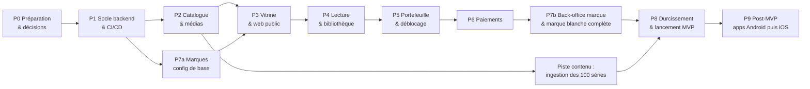

# 06 — IMPLEMENTATION PLAN · Plan d'exécution

| | |
|---|---|
| Version | 0.2 — **brouillon soumis à validation** (0.2 : registre des licences bloquant, piste d'ingestion de 100 séries, PayTech prioritaire, phase 2 stores détaillée) |
| Date | 2026-10-19 |
| Références | [01-PRD](01-PRD.md) · [02-TRD](02-TRD.md) · [03-APPFLOW](03-APPFLOW.md) · [04-UI-UX-Design](04-UI-UX-Design.md) · [05-BACKEND-SCHEMA](05-BACKEND-SCHEMA.md) |

Règles d'exécution (rappel du cadre) : une phase à la fois ; chaque tâche est livrée sur une branche dédiée, avec tests, revue et merge request vers `develop` ; aucune opération destructive, aucun déploiement en production, aucune rotation de secret sans accord explicite ; chaque fin de phase donne lieu à une démonstration et à une validation.

Les durées sont des **ordres de grandeur pour un binôme backend + frontend** et seront recalées après la phase P1.

---

## 1. Vue d'ensemble

La **piste contenu** démarre dès que l'import en lot est livré (fin P2). Elle avance en parallèle du développement, portée par un opérateur de contenu, et ne contient que les séries dont la licence est enregistrée.

| Phase | Objet | Durée indicative |
|---|---|---|
| P0 | Validation, maquettes, comptes, **registre des licences**, inventaire du contenu | 1–2 sem. (démarches externes possiblement plus longues) |
| P1 | Socle backend, identité globale, CI/CD, staging | 2 sem. |
| P2 | Catalogue, licences, médias Bunny, **import en lot**, BO catalogue | 2,5 sem. |
| Piste contenu | Ingestion et relecture des 100 séries (~6 000 épisodes) | 6–8 sem. en parallèle de P3 à P8 **[À CONFIRMER]** selon Q-10 |
| P7a | Marques : création, domaines, résolution, branding de base | 1 sem. |
| P3 | Vitrine + site web public SSR/PWA | 2 sem. |
| P4 | Lecture protégée, progression, favoris | 1,5 sem. |
| P5 | Portefeuille, grand livre, déblocage | 1,5 sem. |
| P6 | Paiements PayTech (obligatoire), webhooks, rapprochement ; Wave direct et PayDunya si le temps le permet | 2–3 sem. |
| P7b | Back-office marque, prix, vitrine, équipe | 1,5 sem. |
| P8 | Sécurité, performance, exploitation, pilote | 2 sem. |
| **Total MVP** | | **≈ 17–19 semaines**, sous réserve que la piste contenu et les licences suivent |

## 2. Phases et tâches

Notation : `T<phase>.<n>` · **Dép.** = dépendances · **Exig.** = exigences couvertes.

### P0 — Préparation et décisions

| Tâche | Description | Dép. | Livrable |
|---|---|---|---|
| T0.1 | Validation des 6 documents ; arbitrage des questions Q-01 à Q-09 | — | Documents v1.0 |
| T0.2 | **Registre des licences (bloquant)** : pour chacune des 100 séries, contrat écrit avec l'ayant droit, territoires SN/GM, dates, mode d'exploitation, langues, droit de sous-licence, exigence DRM. Une série sans contrat n'entre pas dans la piste contenu. | — | Registre (tableur) + contrats numérisés |
| T0.3 | Comptes fournisseurs : **PayTech** en production (compte d'encaissement), URL d'IPN, question des cartes gambiennes (Q-11) ; Wave SN et PayDunya en secours ; démarche Wave Business Gambie (sans urgence) | — | Comptes, référents |
| T0.9 | **Inventaire du contenu** : nombre d'épisodes par série, durée, format et résolution des fichiers, présence de sous-titres FR/EN, affiches (Q-10) ; décision sur la transcription automatique | T0.2 | Inventaire + manifeste CSV modèle |
| T0.4 | Maquettes haute fidélité (SCR-01, 04, 05, 06, 07, 09, BO-11) et prototype du parcours de conversion | T0.1 | Maquettes validées |
| T0.5 | Bunny : bibliothèques `staging` / `prod`, zone de diffusion, authentification par jeton activée, profils d'encodage | — | Bibliothèques configurées |
| T0.6 | Dépôts GitHub `gaatshort-backend`, `gaatshort-backoffice`, `gaatshort-web` ; protections de branche ; environnements GitHub `staging` et `production` avec approbation | T0.1 | Dépôts vides protégés |
| T0.7 | CapRover : apps `api`, `worker`, `web`, `backoffice` sur staging ; base PostgreSQL ; Redis ; stockage objet | T0.6 | Infra staging |
| T0.8 | Avis juridique et comptable (données personnelles, TVA, conservation) | T0.1 | Note de cadrage |

**Critères d'acceptation P0** : documents validés ; compte PayTech utilisable en staging ; registre des licences ouvert, avec au moins les séries du premier lot d'ingestion documentées (contrat, territoires, dates) ; inventaire du contenu réalisé.

### P1 — Socle backend et CI/CD

| Tâche | Description | Dép. | Exig. |
|---|---|---|---|
| T1.1 | Importer le socle `sooba-impact-backend` (shared, infrastructure, config, bootstrap, tenancy, localization, notifications, compliance, analytics) **sans** les modules SOOBA ; renommer ; nouvelle migration initiale | T0.6 | — |
| T1.2 | Remonter `Money` dans `shared/kernel` ; retirer `currencies.rate_to_xof` ; tests | T1.1 | NFR-MONEY-001 |
| T1.3 | Portage CI GitLab → **GitHub Actions** (install, lint, depcruise, typecheck, openapi:diff, unit, integration Testcontainers, e2e, build image, push GHCR, deploy CapRover, smoke de version) | T1.1, T0.7 | — |
| T1.4 | Module `identity` : `users` global, `tenant_memberships`, rôles staff plateforme/marque, jetons liés au tenant, audience BACKOFFICE | T1.1 | FR-AUTH-001, 003, 004 |
| T1.5 | OTP SMS : adaptateur SMS (fournisseur à choisir), quotas par numéro/IP/préfixe, anti-pompage | T1.4 | FR-AUTH-001, NFR-SEC-004 |
| T1.6 | Résolveurs `domain`, `app-key`, en-tête interne signé du serveur web ; désactivation de `header` en prod publique | T1.1 | NFR-SEC-001 |
| T1.7 | RLS sur les tables tenant + vue `tenant_members_v` + règles dependency-cruiser (accès `users`) | T1.4 | NFR-SEC-001 |
| T1.8 | **Suite de tests d'isolation** générée : pour chaque table tenant, lecture/écriture croisée en SQL brut et via API ⇒ échec attendu | T1.7 | NFR-SEC-001 |
| T1.9 | Import du back-office Vue 3 (cœur, auth OTP e-mail, RBAC, i18n FR/EN, thème) ; MFA TOTP pour rôles plateforme | T1.4 | BO-01 |

**Critères d'acceptation P1** : pipeline vert de bout en bout jusqu'au staging ; smoke test vérifie la version ; tests d'isolation bloquants en CI ; connexion OTP fonctionnelle en staging (SMS réel) ; couverture domaine ≥ 90 %.

### P2 — Catalogue, licences, médias

| Tâche | Description | Dép. | Exig. |
|---|---|---|---|
| T2.1 | Module `catalog` : séries, traductions, genres, épisodes, statuts, règles de publication | T1.1 | FR-ADM-001 |
| T2.2 | Licences, territoires, `series_available`, alertes d'expiration à 30 j | T2.1 | FR-ADM-004, FR-CAT-007 |
| T2.3 | `VideoProviderPort` + adaptateur Bunny (création, signature TUS, lecture d'état, sous-titres, signature de lecture) + adaptateur simulé pour tests | T1.1, T0.5 | FR-ADM-002 |
| T2.4 | Webhook Bunny (déclencheur) + job `media.sync` (relecture d'état) | T2.3 | FR-ADM-002 |
| T2.5 | Images (affiches, bannières) sur stockage objet + variantes redimensionnées | T1.1 | FR-CAT-004 |
| T2.6 | Back-office BO-03, BO-04, BO-05 (téléversement TUS reprenable, progression), BO-06 | T2.1–T2.4, T1.9 | FR-ADM-001..004 |
| T2.7 | **Import en lot** : bucket de dépôt, manifeste CSV, validation ligne par ligne, récupération par URL côté Bunny, 20 encodages en parallèle, idempotence, reprise, rapport d'erreurs (TRD §7.6) | T2.3 | FR-ADM-009, D-09 |
| T2.8 | BO-17 Imports (dépôt du manifeste, avancement, relance) | T2.7, T1.9 | FR-ADM-009 |
| T2.9 | Option sous-titres : transcription automatique Bunny par langue + écran de relecture (S, selon T0.9) | T2.3 | FR-VIDEO-004 |
| T2.10 | Marque maison (`is_first_party`) et règle de sous-licence dans `series_available` ; contrat joint obligatoire pour autoriser la sous-licence | T2.2 | D-13 |

**Critères** : une série de test de 10 épisodes est téléversée, encodée (240p→720p), sous-titrée FR/EN et publiée depuis le back-office ; une série de 60 épisodes est importée par manifeste sans aucun téléversement manuel, et un second import du même manifeste ne crée aucun doublon ; une licence expirée rend la série indisponible sans action manuelle ; une série sans sous-licence n'est pas proposée à une marque tierce.

### Piste contenu — ingestion des 100 séries (parallèle, dès la fin de P2)

| Tâche | Description | Dép. |
|---|---|---|
| TC.1 | Dépôt des masters dans le bucket de dépôt, par lots de 10 séries | T2.7, T0.2 |
| TC.2 | Rédaction des manifestes (titres et synopsis FR/EN, genres, affiches) | T0.9 |
| TC.3 | Import, suivi des échecs, relance | T2.8 |
| TC.4 | Sous-titres : import des fichiers fournis ou transcription automatique + relecture | T2.9 |
| TC.5 | Relecture éditoriale (ordre des épisodes, qualité, métadonnées), passage en PUBLISHED | TC.3 |

**Critère** : 100 séries `PUBLISHED`, chacune adossée à une licence valide, avant le pilote (T8.7). À défaut, le lancement se fait avec les séries prêtes, et le seuil minimal est à fixer par le porteur.

### P7a — Marques : configuration de base

| Tâche | Description | Dép. | Exig. |
|---|---|---|---|
| T7.1 | BO-12 / BO-13 (identité, pays/devises/langues, branding de base, statut) | T1.9 | FR-TEN-001, 003, 004 |
| T7.2 | Domaines : vérification DNS par jeton TXT, rattachement CapRover + certificat | T7.1 | FR-TEN-002 |
| T7.3 | Endpoint `GET /storefront/config` (branding, langues, moyens actifs), mis en cache | T7.1 | FR-TEN-003 |

### P3 — Vitrine et site web public

| Tâche | Description | Dép. | Exig. |
|---|---|---|---|
| T3.1 | Module `storefront` : `tenant_series`, rangées, items, calcul des prix/gratuités effectifs | T2.1, T7.1 | FR-CAT-001, FR-TEN-005 |
| T3.2 | Recherche (`pg_trgm` + `unaccent`) et filtres | T3.1 | FR-CAT-003 |
| T3.3 | Classements Populaires/Nouveautés (`series_stats_daily`, job 15 min) | T3.1 | FR-CAT-005 |
| T3.4 | Dépôt `gaatshort-web` : Next.js, thème par jetons, i18n, résolution de marque par hôte, client API généré | T7.3 | D-10 |
| T3.5 | Écrans SCR-01, 02, 03, 04, 17 en rendu serveur ; SEO (métadonnées, Open Graph, sitemap par marque, hreflang) | T3.1–T3.4, T0.4 | FR-CAT-001..008 |
| T3.6 | PWA : manifeste par marque, service worker (vitrine et images hors ligne), installation | T3.5 | FR-VIDEO-007, §8 UI |
| T3.7 | Budget de performance en CI (Lighthouse CI mobile, poids JS) | T3.5 | NFR-PERF-003 |

**Critères** : sur un domaine de marque de staging, l'accueil s'affiche en < 2,5 s LCP (4G simulée) ; deux marques affichent des catalogues et des couleurs différents depuis le même déploiement.

### P4 — Lecture et bibliothèque

| Tâche | Description | Dép. | Exig. |
|---|---|---|---|
| T4.1 | Module `playback` : décision d'accès (publication, licence/pays, gratuité, droit), émission d'URL signée (jeton de répertoire, 30 min), limitation de débit | T2.3, T3.1 | FR-VIDEO-006 |
| T4.2 | Lecteur web vertical (hls.js / natif Safari), enchaînement, glissement, sous-titres, économie de données, renouvellement de session | T4.1, T3.5 | FR-VIDEO-001..005, 007 |
| T4.3 | Progression (`PUT /playback/progress`), reprise, fusion de la progression anonyme au login | T4.1, T1.4 | FR-VIDEO-003 |
| T4.4 | Événements de lecture (lot), partitions mensuelles | T4.2 | analytics |
| T4.5 | Favoris, Continuer à regarder (SCR-13) | T4.3 | FR-LIB-001, 002 |

**Critères** : test e2e « épisode payant sans droit ⇒ 402, aucune URL délivrée » ; URL copiée inutilisable après expiration ; reprise de lecture à ±10 s.

### P5 — Portefeuille et déblocage

| Tâche | Description | Dép. | Exig. |
|---|---|---|---|
| T5.1 | Module `wallet` : portefeuilles, grand livre immuable (trigger), contrôles de solde, vérification quotidienne solde = Σ écritures | T1.7 | FR-MON-002, S05 |
| T5.2 | Déblocage transactionnel + idempotence + `entitlements` | T5.1, T4.1 | FR-MON-003 |
| T5.3 | SCR-06 feuille de déblocage, SCR-15 portefeuille | T5.2, T0.4 | FR-MON-002, 003 |
| T5.4 | Ajustement support (bonus uniquement, motif, audit) — BO-07 | T5.1 | FR-ADM-006 |
| T5.5 | Lots bonus FIFO + expiration ; déblocage automatique avec annulation 5 s | T5.2 | FR-MON-004, 006 (S) |
| T5.6 | Tests de concurrence (50 déblocages simultanés, solde pour 10) | T5.2 | NFR |

**Critères** : test de concurrence ⇒ exactement 10 droits, solde 0, jamais négatif ; double requête avec la même clé ⇒ un seul débit.

### P6 — Paiements

| Tâche | Description | Dép. | Exig. |
|---|---|---|---|
| T6.1 | Module `billing` : packs et prix par devise, commandes, machine à états, historique | T5.1 | FR-MON-005, FR-PAY-011 |
| T6.2 | `PaymentProviderPort` + adaptateur **FAKE** (simule succès, échec, en attente, notifications dupliquées, retardées, falsifiées) | T6.1 | R-07 |
| T6.3 | Boîte de réception des notifications (chiffrement du corps, déduplication), worker de traitement, crédit transactionnel | T6.2, T5.1 | FR-PAY-006 |
| T6.4 | Adaptateur **PayTech — prioritaire** (`request-payment`, `target_payment` par moyen, préremplissage du numéro, `hmac_compute`, `get-status`, `refund-payment`, IPN de remboursement) ; configuration SN (Wave, Orange Money, Free Money, carte) et GM (carte en XOF) | T6.3, T0.3 | FR-PAY-002, D-12 |
| T6.5 | Adaptateur **Wave direct** (S) (signature des requêtes, vérification `Wave-Signature`, `GET` session, `refund`, `expire`) | T6.3 | FR-PAY-001 |
| T6.6 | Interrogation active des commandes en attente, expiration, rattrapage `EXPIRED → SUCCEEDED` | T6.3 | FR-PAY-007, 011 |
| T6.7 | Écrans SCR-07, SCR-08, SCR-09 (+ bannière « paiement en cours » à la réouverture) | T6.1, T0.4 | FR-PAY-005, 007 |
| T6.8 | Historique et reçus (SCR-15) | T6.1 | FR-PAY-008 |
| T6.9 | Rapprochement quotidien, BO-09 | T6.4, T6.5 | FR-PAY-010 |
| T6.10 | Remboursements (API et manuel), reprise des crédits, BO-08 | T6.4, T6.5, T5.1 | FR-PAY-009 |
| T6.11 | BO-16 comptes fournisseurs (secrets chiffrés, test de connexion) ; sélection des moyens par marque et pays | T6.1 | FR-PAY-005 |
| T6.12 | Adaptateur **PayDunya** (S) | T6.3 | FR-PAY-003 |
| T6.13 | Recette réelle en staging : achats réels à faible montant via PayTech avec Wave, Orange Money, Free Money et carte (dont une carte gambienne si Q-11 est positive), rejeu de notifications, remboursement ; procès-verbal | T6.4, T6.6–T6.10 | Critères PRD 2–5, 9 |

**Critères** : critères d'acceptation 2, 3, 4, 5 et 9 du PRD démontrés, dont au moins un achat réel par moyen de paiement PayTech en staging.

### P7b — Back-office marque et marque blanche complète

| Tâche | Description | Dép. | Exig. |
|---|---|---|---|
| T7.4 | BO-11 sélection du catalogue (filtré par licences sous-licenciables), gratuités, prix, packs | T3.1, T6.1 | FR-TEN-005 |
| T7.5 | BO-10 composition de la vitrine avec aperçu mobile | T3.1 | FR-CAT-001 |
| T7.6 | BO-14 équipe et rôles de marque ; BO-15 audit | T1.9 | FR-TEN-006, NFR-SEC-005 |
| T7.7 | Branding complet (police d'affichage, contrôle de contraste, icônes PWA générées) | T7.1, T3.6 | FR-TEN-003 |
| T7.8 | Rapports revenus et reversement par marque (S) | T6.1 | FR-TEN-007 |
| T7.9 | Contrôles d'activation d'une marque (FLOW-14 étape 7) | T7.4 | FR-TEN-001 |

### P8 — Durcissement et lancement

| Tâche | Description | Dép. |
|---|---|---|
| T8.1 | Revue de sécurité (ASVS L2), tests d'intrusion ciblés (traversée de tenant, webhooks, URLs de lecture, OTP) | P7b |
| T8.2 | Tests de charge : 200 sessions de lecture/s, 50 commandes/s, pics de notifications | P7b |
| T8.3 | Supervision et alertes (Sentry, Prometheus/Grafana, tableaux paiement/lecture) ; procédures d'incident | P6 |
| T8.4 | Sauvegardes de production + **test de restauration** chronométré | T0.7 |
| T8.5 | Pages légales par marque, consentements, procédure d'effacement | T0.8 |
| T8.6 | Clôture de la piste contenu : contrôle final des 100 séries (licence valide, épisodes READY, sous-titres, métadonnées FR/EN) | TC.5 |
| T8.7 | Pilote fermé (une marque, ~50 testeurs, achats réels) ; corrections | T8.1–T8.6 |
| T8.8 | Mise en production (après accord explicite) ; surveillance renforcée 72 h | T8.7 |

### P9 — Après MVP

**P9a — Android (Google Play)** — stratégie TRD §16

| Tâche | Description | Dép. | Exig. |
|---|---|---|---|
| T9.1 | Dépôt `gaatshort-mobile` (Expo), profils EAS par marque, résolveur `app-key`, écrans repris du web (lecture `expo-video`, vitrine, portefeuille) | P8 | D-10 |
| T9.2 | Adaptateur `GOOGLE_PLAY` : vérification serveur, consommation et accusé de réception, RTDN Pub/Sub, achats annulés | T6.3 | FR-PAY-012, 014 |
| T9.3 | Produits consommables par pack (`coin_pack_store_products`), écran de configuration dans BO-11 | T9.2 | FR-PAY-012 |
| T9.4 | Revue de conformité de l'interface (aucune orientation vers le web), fiche Play, politique de confidentialité, test interne puis fermé | T9.1–T9.3 | R-11 |
| T9.5 | Notifications push | T9.1 | FR-NOTIF-004 |

**P9b — iOS (App Store)**

| Tâche | Description | Dép. | Exig. |
|---|---|---|---|
| T9.6 | Adaptateur `APP_STORE` : StoreKit 2, App Store Server API, Server Notifications V2 (remboursements) | T6.3 | FR-PAY-013, 014 |
| T9.7 | Soumission de la marque maison sous le compte de la plateforme ; pour chaque marque tierce, soumission sous son propre compte (règle 4.2.6) | T9.6 | R-11 |

**Autres évolutions** : Wave Gambie et prix en GMD (dès l'ouverture du compte, configuration seule), abonnement VIP, publicité récompensée, Orange Money direct, comptes marchands propres aux marques, téléchargement hors ligne, DRM si exigé par un contrat, nouveaux pays, réexamen de la facturation alternative des stores (2027).

## 3. Tâches transverses par discipline

| Discipline | Tâches |
|---|---|
| Frontend web | T3.4–T3.7, T4.2, T4.5, T5.3, T6.7, T6.8 |
| Back-office | T1.9, T2.6, T5.4, T6.9–T6.11, T7.1, T7.4–T7.9 |
| Backend | T1.1–T1.8, T2.1–T2.5, T3.1–T3.3, T4.1, T4.3, T4.4, T5.1, T5.2, T5.5, T6.1–T6.6, T6.12 |
| Infra / DevOps | T0.5–T0.7, T1.3, T7.2, T8.3, T8.4 |
| Sécurité | T1.5–T1.8, T4.1, T6.3, T8.1 |
| Paiement | T6.* |
| Streaming | T2.3, T2.4, T4.1, T4.2 |
| Tests / QA | T1.8, T3.7, T5.6, T6.2, T6.13, T8.2 |

## 4. Stratégie de tests

| Niveau | Contenu | Outil |
|---|---|---|
| Unitaire | Domaine (machine à états, calcul des prix, gratuités, grand livre), ≥ 90 % sur `domain/` | Jest (backend), Vitest (front) |
| Intégration | RLS et isolation, transactions de paiement, idempotence, outbox, verrous | Jest + Testcontainers (Postgres, Redis) |
| Contrat | Adaptateurs fournisseurs contre des réponses enregistrées (signature, statuts, erreurs) | Jest + fixtures |
| E2E API | Parcours conversion complet avec adaptateur FAKE | supertest |
| E2E UI | Parcours FLOW-01, 06, 07, 08 sur mobile émulé et réseau lent | Playwright |
| Charge | Lecture, commandes, notifications | k6 |
| Recette réelle | Paiements réels à faible montant | Procès-verbal manuel (T6.13) |

## 5. Risques d'exécution et atténuation

| Risque | Atténuation |
|---|---|
| Comptes fournisseurs/licences en retard (P0) | Démarrage technique avec l'adaptateur FAKE ; tâches P6 réelles en dernier |
| **Licences non documentées pour une partie des 100 séries** | Ingestion par lots, uniquement des séries au registre ; lancement sur la marque maison ; seuil minimal de séries fixé par le porteur |
| Ingestion plus lente que prévu (~6 000 épisodes) | Import en lot livré dès P2 ; opérateur de contenu dédié ; dépôt des masters depuis un serveur |
| Écart entre la documentation fournisseur et le comportement réel | Tests de contrat alimentés par les réponses réelles capturées en staging |
| Adaptation identité globale du socle plus coûteuse que prévu | Tâche isolée T1.4 avec revue d'architecture dédiée avant P2 |
| Dérive de périmètre | Toute nouvelle exigence passe par mise à jour des 6 documents |
| Performance réelle sur réseaux sénégalais | Mesures terrain pendant le pilote (T8.7) sur 3 opérateurs |

## 6. Migration de données

Pas de données existantes à migrer. Données initiales :
- Référentiels (pays SN/GM, devises XOF/GMD, genres FR/EN, rôles) : seed idempotent versionné.
- Catalogue de lancement : script d'import T2.7 (rejouable, idempotent par `slug`).
- Aucun utilisateur ni paiement importé.

## 7. Stratégie de déploiement

- `develop` → déploiement automatique en **staging** ; `main` (tag `vX.Y.Z`) → **production** après approbation de l'environnement GitHub.
- Image unique taguée par SHA ; migrations en *expand/contract* ; `start-first` + healthcheck + smoke de version (mécanique du socle).
- Nouvelles fonctions sensibles derrière des drapeaux par marque (`feature_flags`) : ex. activer PayDunya pour une seule marque.
- Le web et le back-office sont déployés indépendamment de l'API, compatibles N-1 grâce au versionnement d'API.

## 8. Stratégie de retour arrière

| Composant | Retour arrière |
|---|---|
| API / workers | Redéploiement du tag précédent (`caprover deploy --imageName <sha précédent>`) ; Swarm annule automatiquement si le healthcheck échoue |
| Migrations | Uniquement additives en production ; la partie *contract* n'est appliquée qu'une version plus tard ⇒ l'ancienne version reste compatible |
| Web / back-office | Redéploiement de l'image précédente |
| Fournisseur de paiement défaillant | Changement de priorité dans `tenant_payment_methods` (sans déploiement) |
| Corruption de données | Restauration PITR sur une base parallèle, puis réconciliation ciblée — jamais de restauration écrasant la production sans accord |

## 9. Critères de préparation à la production

- [ ] Les 10 critères d'acceptation du PRD (§13) sont démontrés et consignés.
- [ ] Tests d'isolation, d'idempotence et de concurrence verts en CI.
- [ ] Achat réel réussi, notification rejouée, notification falsifiée et remboursement testés pour chaque fournisseur actif.
- [ ] Comptes marchands en production et URLs de notification de production enregistrées chez chaque fournisseur.
- [ ] Licences du catalogue de lancement vérifiées et saisies (territoires, dates, sous-licence), contrat joint pour chaque série publiée.
- [ ] Séries de lancement importées, relues et publiées (objectif : 100).
- [ ] Lecture testée sur : Android entrée de gamme (Chrome), iPhone (Safari), desktop Chrome/Firefox ; en 3G/4G réelles.
- [ ] Budgets de performance tenus (NFR-PERF-001..003).
- [ ] Sauvegardes actives et restauration testée (RTO mesuré).
- [ ] Alertes paiement, lecture et disponibilité actives, destinataires d'astreinte définis.
- [ ] Pages légales, consentements, procédure d'effacement en place ; avis juridique reçu.
- [ ] Revue de sécurité sans vulnérabilité critique ou haute ouverte.
- [ ] Procédures d'exploitation : incident paiement, incident vidéo, rollback, rotation de secret.

## 10. Matrice de traçabilité (exigences principales)

| Exigence | Flux | Écran | Backend (module · tables) | Test | Tâche |
|---|---|---|---|---|---|
| FR-AUTH-001 | FLOW-01 | SCR-10, 11 | identity · users, auth_challenges | e2e OTP + quotas | T1.4, T1.5 |
| FR-AUTH-004 | FLOW-01 | SCR-12 | identity · tenant_memberships | intégration : rattachement par marque | T1.4 |
| FR-AUTH-006 | FLOW-10 | SCR-14 | compliance · users (anonymisation) | intégration effacement | T8.5 |
| FR-CAT-001 | FLOW-04 | SCR-01 | storefront · storefront_rows | e2e UI accueil | T3.1, T3.5 |
| FR-CAT-007 | FLOW-04, 06 | SCR-01, 04 | catalog · licenses, `series_available` | unitaire + intégration licence expirée | T2.2 |
| FR-CAT-008 | FLOW-04 | SCR-04 | web SSR | Lighthouse SEO | T3.5 |
| FR-VIDEO-001 | FLOW-06 | SCR-05 | media · Bunny | e2e UI lecture | T4.2 |
| FR-VIDEO-003 | FLOW-06 | SCR-05, 13 | playback · watch_progress | e2e reprise | T4.3 |
| FR-VIDEO-006 | FLOW-06 | SCR-05 | playback · entitlements | e2e 402 + expiration URL | T4.1 |
| FR-LIB-001 | FLOW-11 | SCR-13 | library · favorites | intégration | T4.5 |
| FR-MON-002 | FLOW-09 | SCR-15 | wallet · wallets, wallet_ledger_entries | intégration solde = Σ écritures | T5.1 |
| FR-MON-003 | FLOW-07 | SCR-06 | wallet · entitlements | concurrence T5.6 | T5.2 |
| FR-MON-005 | FLOW-08 | SCR-07 | billing · coin_packs, coin_pack_prices | unitaire prix par devise | T6.1 |
| FR-PAY-001 (S) | FLOW-08 | SCR-08, 09 | billing · adaptateur Wave direct | contrat | T6.5 |
| FR-PAY-002 | FLOW-08 | SCR-08, 09 | billing · adaptateur PayTech | contrat + recette réelle | T6.4, T6.13 |
| FR-PAY-012, 013 | FLOW-17 | SCR-07, 09 | billing · adaptateurs GOOGLE_PLAY / APP_STORE, coin_pack_store_products | contrat + tests store | T9.2, T9.3, T9.6 |
| FR-PAY-014 | FLOW-08, 17 | SCR-15 | wallet · wallets (portefeuille commun) | intégration : achat web visible dans l'app | T6.1, T9.2 |
| FR-ADM-009 | FLOW-13b | BO-17 | catalog · catalog_imports, catalog_import_items | intégration : réimport sans doublon | T2.7, T2.8 |
| FR-PAY-006 | FLOW-08 | SCR-09 | billing · payment_provider_events, ledger | rejeu ×5, signature falsifiée, statut divergent | T6.3 |
| FR-PAY-009 | FLOW-16 | BO-08 | billing · refunds | intégration remboursement | T6.10 |
| FR-PAY-010 | FLOW-16 | BO-09 | billing · reconciliation_* | intégration écart simulé | T6.9 |
| FR-ADM-002 | FLOW-13 | BO-05 | media · media_assets | intégration webhook + relecture | T2.3, T2.4 |
| FR-ADM-004 | FLOW-13 | BO-06 | catalog · licenses | unitaire règles de publication | T2.2 |
| FR-TEN-002 | FLOW-14 | BO-13 | tenancy · tenant_domains | e2e résolution par domaine | T7.2 |
| FR-TEN-005 | FLOW-14 | BO-11 | storefront · tenant_series | intégration sous-licence requise | T7.4 |
| NFR-SEC-001 | toutes | toutes | RLS · toutes tables tenant | suite d'isolation T1.8 (bloquante) | T1.7, T1.8 |
| NFR-SEC-005 | FLOW-15, 16 | BO-15 | audit_logs | intégration immuabilité | T7.6 |
| NFR-DATA-001 | — | — | sauvegardes | restauration chronométrée | T8.4 |
| NFR-PERF-001 | FLOW-06 | SCR-05 | Bunny / lecteur | mesures terrain | T8.7 |

### 10.1 Couverture des autres exigences

| Exigence(s) | Couverte(s) par |
|---|---|
| FR-AUTH-002 (OTP e-mail, S) | T1.5 (même mécanisme, canal e-mail du socle) |
| FR-AUTH-003, FR-AUTH-005, FR-AUTH-007 | T1.4 (sessions), T4.1 (lecture anonyme des gratuits), T4.3 et SCR-14 (préférences) |
| FR-CAT-002, FR-CAT-006 | T3.1, T3.5 (genres, traductions avec repli) |
| FR-VIDEO-002, 004, 005 | T4.2 |
| FR-LIB-002, FR-LIB-003 | T4.5, T5.3 |
| FR-MON-001 | T3.1 (gratuité effective), T7.4 (surcharge marque) |
| FR-MON-006 (S) | T5.5 |
| FR-ADM-003 | T2.6 (sous-titres WebVTT) |
| FR-ADM-005 (S) | T3.1 (`tenant_series.status = SCHEDULED`, `live_from`) |
| FR-ADM-007 | T6.10 (BO-08) |
| FR-ADM-008 (S) | T7.8 + T4.4 (agrégats) |
| FR-NOTIF-001 | T1.5 |
| FR-NOTIF-002 | T6.7 (notification in-app sur `billing.order.paid` / échec, via module notifications du socle) |
| FR-NOTIF-003 (S) | T4.5 (centre de notifications SCR-16, événement « nouvel épisode d'une série favorite ») |
| FR-TEN-004 | T7.1 |
| NFR-SEC-002, 003 | T8.1 ; T1.3 (analyse des dépendances et des images, aucun secret en dépôt) ; T6.11 (secrets chiffrés) |
| NFR-I18N-001 | T1.9, T3.4 (i18n FR/EN dès le départ, formatage monétaire par devise) |
| NFR-A11Y-001 | T3.5, T4.2 (critères d'acceptation par écran), T8.1 (audit) |
| NFR-OBS-001, NFR-AVAIL-001, NFR-PERF-002 | T8.3, T8.2 |
| NFR-COMP-001 | T0.8, T8.5 |
| FR-PAY-003 (S) | T6.12 |
| Reportées (L) : FR-MON-007..009, FR-NOTIF-004 (T9.5), FR-PAY-004, FR-PAY-012..013 (P9a/P9b), FR-TEN-008, FR-VIDEO-008, 009 | P9 |
